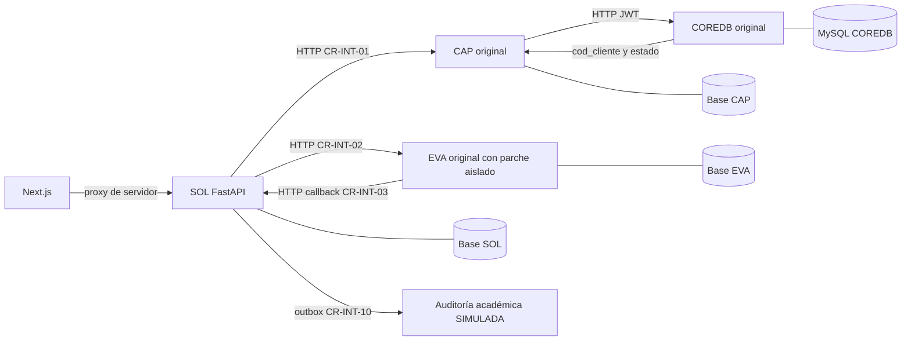

# Arquitectura y autoridad de datos de SOL

> Estado: **VIGENTE**. Última verificación documental: **2026-11-16** (código y evidencias existentes; sin repetir pruebas funcionales). Rama: `feature/sol-integracion-cap-eva`; SHA: `988dc0776da282fbef306632fc86426b6e372376`. Principal: [README SOL](../README.md).

## Responsabilidades y recorrido

CAP verifica/habilita y usa COREDB para registrar o recuperar el cliente; devuelve el código COREDB como id_cliente. SOL consulta CAP, valida condiciones y guarda expediente/versiones/calendario preliminar en su propia base. EVA recibe el sobre congelado, evalúa con su flujo académico y devuelve la decisión por callback. SOL registra esa decisión; no evalúa riesgo, no autoriza ni ejecuta desembolso y no administra cobranza.

## Código y procesos

| Componente | Fuente y función |
|---|---|
| API SOL | [app.py](../../../backend/SOL/app.py): rutas, sesiones, roles, transacciones y callback. |
| Validaciones | [schemas.py](../../../backend/SOL/schemas.py), [service.py](../../../backend/SOL/service.py), [policy.py](../../../backend/SOL/policy.py): DTO estrictos, snapshots y política. |
| Dinero/calendario | [finance.py](../../../backend/SOL/finance.py), [clock.py](../../../backend/SOL/clock.py): Decimal y fecha de Lima. |
| Persistencia | [models.py](../../../backend/SOL/models.py), [database.py](../../../backend/SOL/database.py), [migrations.py](../../../backend/SOL/migrations.py): tablas mvp_sol_* y migración explícita. |
| Integración | [integrations.py](../../../backend/SOL/integrations.py), [operations.py](../../../backend/SOL/operations.py), [settings.py](../../../backend/SOL/settings.py): HTTP, outbox, workers y configuración fail-fast. |
| Seguridad local | [security.py](../../../backend/SOL/security.py): hashes de claves/tokens; rol verificado en servidor. |
| COREDB | [main.py](../../../backend/COREDB/main.py): clientes/verificaciones/auth/catálogos; no API HTTP de evaluaciones. |
| CAP/EVA |Fuentes Git fijadas, exportadas por [prepare.py](../laboratorio/prepare.py); no paquetes incorporados a HEAD. |
| Frontend | [page.tsx](../../../frontend/app/solicitud-credito/page.tsx) y [proxy](../../../frontend/app/api/solicitud-credito/%5B...path%5D/route.ts): UI y cookie HttpOnly. |

## Persistencia, versiones y entrega

Application mantiene estado, versión vigente y revisión optimista. Version guarda identidad mínima, condiciones, respaldos, política y calendario. Enviar congela versión y reserva Delivery en transacción antes del HTTP:202 local no acredita recepción EVA. Worker consulta operación; solo404 permite POST. Acuse completo confirma Delivery y cambia a EN_EVALUACION. Reintentos reutilizan operación y la restricción solicitud/versión evita duplicación.

Outcome valida evaluación/ronda/versión del acuse. Callback idéntico repetido se reconoce; contenido distinto, versión vieja o ronda incompatible se rechazan. OBSERVADA permite nueva versión con revise; la anterior queda inmutable. Los eventos y AuditOutbox se guardan juntos; entrega de auditoría y entrega a EVA son independientes.

Dos servidores MySQL efímeros del laboratorio: uno integrado COREDB y otro con bases/usuarios distintos para CAP/SOL/EVA. SOL no accede a schemas creditos.* de COREDB. Un tercer MySQL solo se utiliza para suite EVA; nunca se confunde con persistencia del circuito.

## Autenticación y despliegue

SOL usa sesión local de laboratorio, roles ASESOR/SUPERVISOR/AUDITOR y evaluador de demo solo SIMULADO. CAP/EVA validan personas por JWT COREDB. Los canales SOL→CAP/SOL→EVA/callback tienen tokens de servicio separados; correspondencias en [contratos](../03-contratos/README.md). REAL incompleto falla explícitamente, sin fallback a datos simulados.

[compose.yaml principal](../../../compose.yaml) mantiene SOL SIMULADO y no incorpora CAP/EVA. El launcher exporta aplicaciones originales de refs y genera un overlay académico fuera de Git, con redes propias, APIs loopback y MySQL tmpfs sin puertos. No es despliegue institucional ni Bus corporativo. `/gateway/sol` es alias del mismo módulo solo SIMULADO, no otro microservicio.

## Procedencia

Consolida [lectura histórica](../06-historico/etapas/LECTURA_DEL_CODIGO.md), [adaptadores](../06-historico/etapas/sol-adaptadores-cap-eva.md), auditorías y [implementación P20](../04-pruebas/p20/01-implementacion.md). Se corrige la antigua suposición de dependencia exclusiva de Bus: los proveedores tienen URL/token propios y ya se ensayaron en laboratorio. Los pendientes institucionales se conservan.
