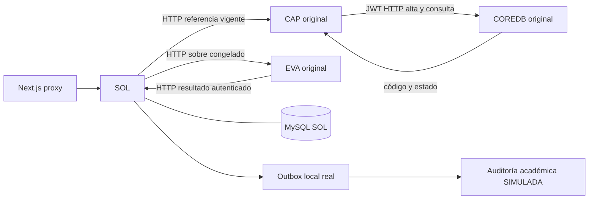

# SOL — Solicitud de Crédito · Banco Nacional Arequipa

> Estado: **VIGENTE**. Última verificación documental/código: **2026-11-16**, America/Lima. Rama: `feature/sol-integracion-cap-eva`; SHA: `988dc0776da282fbef306632fc86426b6e372376`. Documento principal de referencia. Última ejecución funcional registrada: **P20, 2026-11-16**; no se repitieron suites bancarias durante la reorganización documental.

## 1. Identificación y responsabilidad

SOL registra y versiona solicitudes de crédito, condiciones, garantías/fiadores, calendario PRELIMINAR y trazabilidad; remite versiones congeladas a EVA y recibe sus resultados. No evalúa riesgo, no aprueba/ejecuta desembolsos ni administra cobranza. CAP es fuente de referencias habilitadas; COREDB conserva el maestro bancario de clientes.

Tecnologías: Python/FastAPI, Pydantic, SQLAlchemy/PyMySQL, MySQL8.4 en laboratorio, Decimal, HTTPX, Next.js/React/TypeScript y Docker Compose. La receta Python usa3.11 y frontend Node22. Código: [backend SOL](../../backend/SOL/), [COREDB](../../backend/COREDB/), [frontend SOL](../../frontend/app/solicitud-credito/). CAP/EVA no están incorporados como paquetes del árbol actual: el laboratorio exporta aplicaciones originales de refs locales verificadas y les aplica un parche EVA aislado.

## 2. Resumen ejecutivo

**El circuito CAP → COREDB → CAP → SOL → EVA → SOL fue verificado en laboratorio académico**, con aplicaciones originales, transporte HTTP entre servicios independientes y persistencia MySQL. P20 demostró APROBADA, OBSERVADA→nueva versión→APROBADA y RECHAZADA, acuses/idempotencia y recuperación de API EVA. Los verificadores externos CAP y el receptor de auditoría académica siguen simulados.

Están disponibles una demo intermodular reproducible y una demo independiente de SOL SIMULADO. No hay homologación institucional, integración del circuito al Compose principal ni preparación para producción. Fiadores REAL, pago doble y aprobación de política crediticia permanecen pendientes/bloqueados. [Evidencias originales](04-pruebas/p20/evidencias.json), [guía de ejecución](05-despliegue/README.md).

## 3. Estado actual de implementación

Estados: **IMPLEMENTADO Y PROBADO** = código con pruebas registradas y alcance indicado; **IMPLEMENTADO SIN PRUEBA ACTUAL** = código presente sin evidencia de ejecución pertinente; **INTEGRADO EN LABORATORIO** = comunicación intermodular original verificada en entorno académico; **SIMULADO** = dependencia explícitamente sustituida; **PARCIAL** = cobertura incompleta; **BLOQUEADO** = falta decisión/contrato; **NO IMPLEMENTADO** = ausente en el alcance. Ninguno significa homologación institucional. Una prueba registrada no garantiza disponibilidad actual de un contenedor.

| Componente | Estado | Evidencia | Limitaciones |
|---|---|---|---|
| Sesión/roles locales SOL, solicitudes, preview/calendario/garantías | IMPLEMENTADO Y PROBADO |[suite SOL219 y P20](04-pruebas/README.md) |Perfil académico; sin SSO ni verificación institucional de respaldos. |
| COREDB↔CAP y SOL→CAP | INTEGRADO EN LABORATORIO |[150 checks/SQL P20](04-pruebas/p20/evidencias.json) |Fuentes CAP fijadas; verificadores externos simulados. |
| SOL→EVA y EVA→SOL | INTEGRADO EN LABORATORIO |[escenarios y acuses](04-pruebas/p20/03-pruebas-y-evidencias.md) |Requiere parche aislado de acuse EVA; no fusionado en su ref original. |
| Versiones/subsanación/historial/outbox | IMPLEMENTADO Y PROBADO |[operations.py](../../backend/SOL/operations.py),P20v2 y suite SOL |Auditoría central no homologada; durabilidad de laboratorio limitada a tmpfs. |
| Next.js proxy SOL | INTEGRADO EN LABORATORIO |P20 HTTP/cookie HttpOnly/bandeja,114 tests/2 expected fail |Sin navegación visual automatizada P20 ni UI CAP/EVA en este HEAD. |
| Monitoreo ops/pending,ops/metrics y readiness | IMPLEMENTADO Y PROBADO |[app.py](../../backend/SOL/app.py),suite SOL219 |Muestras por proceso, no plataforma central/SLA. |
| Verificadores externos CAP / auditoría académica | SIMULADO |[matriz de alcance](04-pruebas/p20/04-matriz-real-simulado.md) |Transporte real no transforma proveedor simulado en institucional. |
| Fiadores en REAL / pago doble | BLOQUEADO |[matriz RF](02-funcionalidades/matriz-rf.md) |Sin contrato/regla aprobada; bloqueo seguro conservado. |
| Garantías institucionales | PARCIAL |DTO/snapshot y escenario P20 |Declaración implementada; tasación/obligatoriedad/soportes no homologados. |
| Circuito en despliegue principal / Bus corporativo | NO IMPLEMENTADO |[compose principal](../../compose.yaml) |SOL principal sigue SIMULADO; /gateway/sol es alias local, no Bus desplegado. |
| Operación institucional TLS/SSO/auditoría | BLOQUEADO |Contratos/decisiones pendientes |Sin certificación, aprobación ni evidencia productiva. |

## 4. Arquitectura



CAP usa COREDB y expone referencia vigente; SOL la consulta, crea expediente en MySQL propio y envía sobre versionado; EVA persiste en su base, registra decisión y la devuelve a SOL. COREDB no sustituye APIs EVA ni recibe escrituras directas SOL. CAP/SOL/EVA tienen bases/usuarios propios; en laboratorio comparten un servidor auxiliar aislado, separado del servidor COREDB.

Personas CAP/EVA usan JWT COREDB; SOL sesiones locales. Canales de servicio tienen Bearer separados (CAP, EVA, callback y auditoría). Cada envío reserva/congela antes de HTTP;202 no es acuse. Worker consulta operación antes del POST, conserva clave estable, registra acuse y después permite callback compatible con solicitud/versión/evaluación/ronda. Reintentos idénticos no duplican; conflictos se rechazan. Historial y outbox son transaccionales. [Arquitectura detallada](01-arquitectura/README.md).

## 5. Funcionalidades disponibles

Autenticación/autorización en servidor; clientes CAP; registro/edición de borrador por revisión; preview/calendario francés PRELIMINAR con Decimal; garantías declaradas; versionado/congelación; envío asíncrono a EVA; recepción y deduplicación de resultados; subsanaciones preservando versiones previas; historial; bandeja paginada; auditoría local/outbox; métricas y pendientes operativos. La [política](../../backend/SOL/config/politica_demo.json) es propuesta académica: PEN1000–50000,6–60 meses,TEA22%,30 días/días360. No habilita pago doble ni fiadores REAL. [Detalle y límites](02-funcionalidades/README.md).

## 6. Requisitos RF-SOL-001..010

| Requisito | Descripción / estado | Evidencia técnica | Limitación y dependencia pendiente |
|---|---|---|---|
| RF-SOL-001 | Cliente captado — INTEGRADO EN LABORATORIO | integrations.py: reference/validate_reference; P20 SOL consulta CAP y COREDB confirma código | Verificadores externos CAP simulados; identidad/habilitación institucional pendiente. |
| RF-SOL-002 | Plazo — IMPLEMENTADO Y PROBADO | schemas.ApplicationInput, service.prepare, política; suite SOL219 |6–60 meses del perfil académico; ratificación institucional pendiente. |
| RF-SOL-003 | Monto — IMPLEMENTADO Y PROBADO | Decimal15/2, prepare, snapshots; suite SOL219 |1000–50000 PEN propuestos; no política crediticia aprobada. |
| RF-SOL-004 | Moneda — IMPLEMENTADO Y PROBADO | política monedas=[PEN], rechazo de moneda fuera de catálogo |Sin conversión/catálogo institucional nuevo; no habilitar USD por capacidad del DTO EVA. |
| RF-SOL-005 | Pago doble — BLOQUEADO | service.prepare rechaza true; policy rechaza habilitación no soportada |Fórmula/meses/redondeo DA-SOL-005 sin decisión aprobada. El rechazo seguro no implementa el cálculo. |
| RF-SOL-006 | Calendario — IMPLEMENTADO Y PROBADO | finance.calendar, Decimal, snapshot; P20 preview/EVA |PRELIMINAR, francés/30 días/días360/TEA22%; política académica pendiente de ratificación. |
| RF-SOL-007 | Garantías — IMPLEMENTADO Y PROBADO | schemas.Guarantee, máximo10, snapshot; garantía vehicular P20 |Solo declaración/tasación ingresada; obligación, validación y soportes institucionales pendientes. |
| RF-SOL-008 | Fiadores — BLOQUEADO | guarantor_reference permite referencias solo SIMULADO y rechaza REAL; suite SOL219 |Registro sintético disponible; contrato de identidad institucional y reglas de respaldo pendientes. P20 usa lista vacía. |
| RF-SOL-009 | Remisión a EVA — INTEGRADO EN LABORATORIO | Delivery/worker, GET operación antes de POST, acuse; P20 SQL y caída/recuperación |Requiere fuentes EVA fijadas y configuración del laboratorio; no integrado al Compose principal. |
| RF-SOL-010 | Resultado y subsanación — INTEGRADO EN LABORATORIO | callback/Outcome, versión/ronda, revise; P20 APROBADA/OBSERVADA→v2→APROBADA/RECHAZADA |Dictamen académico de EVA; sin desembolso ni homologación de estados/condiciones institucionales. |

[Procedencia y evidencia específica de la matriz](02-funcionalidades/matriz-rf.md). DA-SOL son referencias de trazabilidad; no se inventan actas aprobadas.

## 7. Integraciones y contratos

- **COREDB:** clientes/verificaciones/auth/catálogos por HTTP; no routers de evaluación. CAP lo consume; EVA valida personas por /coredb/auth/me y persiste en su propia BD.
- **CAP:** CR01 GET /cap/references y /cap/references/{id_cliente}; lista no certifica habilitación, SOL reconsulta detalle ACTIVO/HABILITADO y vigencia Lima.
- **EVA:** CR02 POST /eva/applications y GET /eva/operations/{id_operacion}; CR03 POST /sol/integrations/evaluation-results. P20 utiliza EVA original exportada, con [parche de acuse](laboratorio/patch_eva.py) que exige200/JSON/recibido:true/operación exacta.
- **Seguridad/Auditoría:** JWT COREDB para personas CAP/EVA, sesión local SOL; CR10 usa receptor académico simulado, sin modificar servicio institucional. Historial/outbox locales sí son reales.
- **Frontend:** proxy servidor hacia /sol y cookie HttpOnly. `/gateway/sol` y demo-result permanecen solo para modo SIMULADO; no se usaron para cerrar el circuito EVA real.

[Contratos detallados utilizados](03-contratos/README.md), [propuestas históricas](06-historico/contratos/). Las etiquetas PROPUESTA-v2 no significan homologación aunque sean compatibles y hayan sido utilizadas por HTTP.

Fuentes fijadas: CAP `4ea5014bddb1a69289402f03b3fbc47c28cc9413` (`origin/pr-cap-74`), EVA `57b0e2a34fd55fb96fd6245acc06a86536d220f8` (`origin/pr-eva-70`). Son refs Git locales verificadas, no declaración de estado actual de PR remoto. [Preparación](laboratorio/prepare.py) no hace merge/cherry-pick.

## 8. Pruebas y evidencias verificables

Últimas ejecuciones registradas P20; cifras contrastadas con JSON/reportes, no reejecutadas en esta reorganización:

| Ejecución | Resultado | Alcance |
|---|---|---|
| Circuito TCP original |150 controles +2 recuperación EVA |HTTP real +MySQL; APROBADA,OBSERVADA→v2→APROBADA,RECHAZADA. |
| SOL |219 aprobadas |SQLite/mocks; no219 ensayos MySQL reales. |
| COREDB |57 aprobadas |Unidad/auth sin BD. |
| CAP |35 aprobadas,1 módulo omitido;4 contrato adicionales |SQLite/dobles; módulo omitido se ejecutó en imagen SOL con tzdata. |
| EVA |65 aprobadas |MySQL exclusivo de pruebas; COREDB/SOL falsos dentro de suite. |
| Frontend |114 aprobadas,2 fallos esperados |Lint,TypeScript,build0; proxy P20 también comprobado por HTTP. |
| Acuse / infraestructura |9 unitarios+7 TCP;9 negativos estáticos |Complementos, no sustituyen circuito original. |

No sumar ejecuciones/subconjuntos: motor EVA12 está dentro de65 y150 son checks del runner, no casos de pytest. Complementos HTTP403/422/503, idempotencia, callbacks y SQL están en [evidencia original P20](04-pruebas/p20/evidencias.json) y [reporte de ejecución](04-pruebas/p20/03-pruebas-y-evidencias.md). [Índice de pruebas](04-pruebas/README.md) conserva condiciones/comandos y distingue v2/E06/P20. Capturas v2 representan otra etapa, no P20.

## 9. Cómo ejecutar

Desde raíz, con Python3 estándar, Git refs fijadas y Docker/Compose local:

```bash
python3 Documents/solicitud-credito/laboratorio/demo_integracion.py
python3 Documents/solicitud-credito/laboratorio/demo_integracion.py status
python3 Documents/solicitud-credito/laboratorio/demo_integracion.py test
python3 Documents/solicitud-credito/laboratorio/demo_integracion.py regressions
python3 Documents/solicitud-credito/laboratorio/demo_integracion.py stop
```

El primer comando construye/inicializa bases efímeras y ejecuta escenarios; test crea más datos. No son verificaciones solo lectura. Regresiones EVA completas: acción eva-regressions con tercer MySQL exclusivo. Frontend: frontend-regressions. [Guía completa, credenciales y parada](05-despliegue/README.md).

Secretos generados en directorio externo privado, nunca Git. Usuario SOL/Next asesor.bna, clave en runtime/sol-init.env; COREDB admin-lab, clave en runtime/coredb-init.env. No exponerlos en capturas. Default Swagger: COREDB http://127.0.0.1:18120/docs, CAP http://127.0.0.1:18121/docs, SOL http://127.0.0.1:18122/docs y EVA http://127.0.0.1:18123/docs; Next http://127.0.0.1:18124/solicitud-credito. --port18130 desplaza a18130..18134. El último P20 usó --state /tmp/bna-integracion-final-clean.json; repetir ese argumento para consultar esa instancia si todavía existe, sin asumir disponibilidad actual.

La [demo SOL independiente](demo/README.md) usa otro launcher y SIMULADO; no demuestra CAP/EVA originales. Scripts/Compose/OpenAPI históricos E06 se mantienen en ubicación estable por dependencias de rutas, no son el inicio recomendado.

## 10. Qué está simulado

Verificadores externos de CAP (RENIEC/listas/PEP/centrales/SMS según flujo original) y receptor de auditoría académica. CAP/SOL/EVA/COREDB originales **no** se reemplazan por mocks en P20. Las suites unitarias sí emplean dobles y se declaran por separado. No hay fallback silencioso de REAL a SIMULADO. Transporte HTTP real no significa homologación institucional.

## 11. Pendientes y bloqueos

Auditoría institucional/roles centrales/TLS/SSO; identidad de fiadores RF008; pago doble RF005; política de crédito aprobada y respaldos; consolidación del circuito en despliegue principal; operación,backup/retención y durabilidad productivas. MySQL tmpfs pierde datos al parar; recuperación de API no prueba supervivencia ante pérdida del servidor. La prioridad temporal es código/evidencia; no se atribuyen responsables o aprobaciones nuevas sin respaldo.

## 12. Navegación y autoridad documental

| Necesidad | Documento |
|---|---|
| Arquitectura |[01-arquitectura](01-arquitectura/README.md) |
| Funciones y requisitos |[02-funcionalidades](02-funcionalidades/README.md),[matriz RF](02-funcionalidades/matriz-rf.md) |
| Esquemas HTTP y propuestas |[03-contratos](03-contratos/README.md) |
| Resultados y originales |[04-pruebas](04-pruebas/README.md) |
| Instalación/Swagger/reproducción |[05-despliegue](05-despliegue/README.md) |
| Recursos ejecutables |[laboratorio](laboratorio/README.md),[demo](demo/README.md) |
| Antecedentes y reorganización |[06-historico](06-historico/README.md),[informe e inventario](06-historico/REORGANIZACION_DOCUMENTAL.md) |
| Historia de cambios |[change-log.md](change-log.md) |

Este README es la síntesis actual; contratos son fuente específica de formas HTTP y evidencias originales de resultados. Los archivos históricos conservan conclusiones de su etapa y no sobrescriben P20. El [inventario máquina](06-historico/inventario-documental.json) registra destino/categoría/acción de los213 archivos originales, incluidos recursos conservados por compatibilidad.

## 13. Alcance de la conclusión

La integración CAP → SOL → EVA → SOL fue verificada en un laboratorio académico, con aplicaciones originales y transporte HTTP entre servicios independientes. **Esto no representa homologación institucional ni preparación para producción.** Esta reorganización solo valida código/documentos/recursos estáticamente y no crea nuevas pruebas bancarias ni modifica bases.
