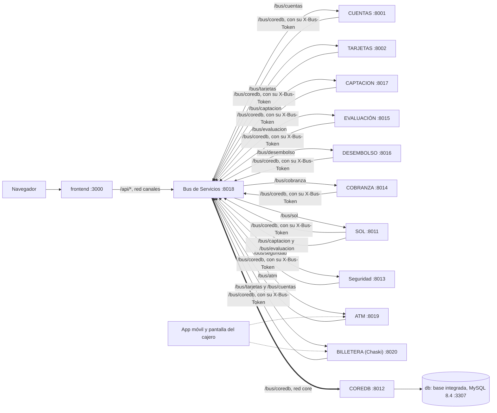
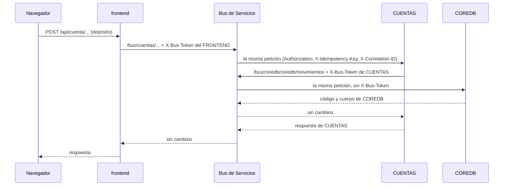

# Banco Nacional de Arequipa (BNA)

Sistema bancario modular, proyecto académico de la UCSM (2026). Este repositorio contiene el producto integrado: la base de datos del CORE, su API, los módulos que ya trabajan sobre ella y el frontend. Todo se levanta en Docker con una orden.

| Parte | Carpeta | Qué hace | Estado |
|---|---|---|---|
| Base integrada | `database/` | MySQL 8.4 con el esquema del CORE: clientes, cuentas, movimientos, tarjetas, contabilidad y bitácora | En uso |
| COREDB | `backend/COREDB` | La API del CORE. Es el único servicio que se conecta a la base integrada | En uso |
| Bus de Servicios | `backend/BUS_SERVICIOS` | Punto único por el que el frontend llega a los módulos y los módulos llegan a COREDB: `/bus/<módulo>/<ruta>` se reenvía sin tocar cabeceras, cuerpo ni códigos, con una credencial por consumidor | En uso |
| CUENTAS | `backend/CUENTAS` | Cuentas de ahorro: apertura, depósito, retiro, transferencia y consultas. No tiene base propia: llama a COREDB | En uso |
| TARJETAS | `backend/TARJETAS` | Tarjetas de débito: emisión, consulta, bloqueo y cambio de estado. No tiene base propia: llama a COREDB | En uso |
| ATM | `backend/ATM` | Cajero automático: pantalla, validar PIN, autorizar retención, dispensar, confirmar (idempotente), extorno, consultar saldo/movimientos. Sin base propia: llama a TARJETAS y CUENTAS por el Bus | En uso |
| BILLETERA (Chaski) | `billetera-chaski/` | Billetera Digital (canal BD): API para la app móvil (login con celular y PIN, envío por celular, cobro y pago con QR, solicitudes de cobro, avisos). Sin base propia: opera sobre COREDB por el Bus; los clientes los registra CAPTACION y el banco los afilia. La app Flutter (`app_movil/`) aún usa ids numéricos y falta adaptarla (#116) | En uso (API); app móvil sin adaptar |
| CAPTACION | `backend/CAPTACION` | Captación de clientes: registro del solicitante, consentimientos, OTP, RENIEC/listas/PEP, centrales y perfil de riesgo; registra al cliente HABILITADO en COREDB y publica la referencia CR-INT-01 que consulta SOL. Sin base propia: el expediente vive en la base integrada (`clientes.*_captacion`) y se trabaja por COREDB | En uso, con proveedores simulados |
| COBRANZA | `backend/COBRANZA` | Cobranza de cuotas de crédito: consulta del cronograma y pago de cuotas en montos fraccionados (CR-INT-07, real en COREDB) y el pago de la pantalla `/pagar-cuota` (CR-INT-08). Sin base propia: el crédito lo crea Desembolso en COREDB y Cobranza lo lee y cobra. Llega a COREDB por el Bus (`/bus/cobranza`) con `BUS_TOKEN_COBRANZA` y su usuario de servicio (`COBRANZA_COREDB_SECRETO`) | En uso: sin base propia, llama a COREDB |
| Frontend | `frontend/` | Banca personal en Next.js: inicio de sesión, cuentas, tarjetas, captación, solicitud de crédito y pago de cuotas (`/pagar-cuota`); pantallas del analista (`/evaluacion`) y del operador de desembolso (`/desembolso`); Home Banking en `/homebanking/index.html` | En uso |
| SOL | `backend/SOL` | Solicitud de crédito: el asesor arma el borrador (condiciones, garantías y fiadores) con clientes de CAPTACION (CR-INT-01), lo envía a Evaluación (CR-INT-02) y recibe el resultado (CR-INT-03). Sin base propia: el borrador y su historial están en COREDB, y sus eventos van a la bitácora de COREDB. Las personas entran con su usuario de COREDB y SOL llega a todo por el Bus | En uso: sin base propia, llama a COREDB, CAPTACION y Evaluación |
| EVALUACIÓN | `backend/EVALUACION` | Evaluación crediticia: recibe el expediente de SOL y lo registra en COREDB; el analista evalúa con la regla RN-EVA-002-P y decide los casos observados. La aprobación queda en COREDB para Desembolso, con el calendario de SOL | En uso: sin base propia, llama a COREDB |
| DESEMBOLSO | `backend/DESEMBOLSO` | Desembolso de créditos: el operador verifica el documento del titular, prepara la orden con una aprobación y una cuenta individual, y confirma; COREDB abona una sola vez, crea el crédito con su calendario oficial y deja la solicitud desembolsada | En uso: sin base propia, llama a COREDB |
| Seguridad | `backend/seguridad` | Evaluación de una operación contra el tope real del canal, con desafío sobre el 80 % (código simulado); sellos HMAC encadenados de la bitácora de COREDB; incidentes; desbloqueo de tarjetas (el único camino). Sin base propia ni usuarios propios: entra el personal con su usuario de COREDB y Seguridad llega a COREDB por el Bus con `svc-seguridad` | En uso: sin base propia, llama a COREDB; ningún canal lo llama aún antes de debitar |

Para contribuir, ver [`CONTRIBUTING.md`](CONTRIBUTING.md): rama, PR y CI en verde; nada directo a `main`.

Lo que no está: el módulo Clientes (el PR #25 se cerró sin fusionar el 2026-11-17; los clientes los crea CAPTACION). El CORE legado (`backend/CORE`, la API anterior sobre el esquema `bna`, con su base `db-legado` y el perfil `legado`) se eliminó en #125 porque ningún servicio lo usaba; sigue en el historial de git. Lo que sigue abierto está en el issue #116; los valores adoptados donde las fuentes no deciden, en [`Documents/decisiones-del-equipo.md`](Documents/decisiones-del-equipo.md). Todo pasa por el Bus de Servicios, como pide [`Documents/01-stack-tecnologico.md`](Documents/01-stack-tecnologico.md): el frontend llega a los módulos a través de él, y los módulos llegan a COREDB también a través de él.

## Requisitos

- Docker con Compose 2.20 o superior, en marcha (`docker compose version`, `docker info`).
- Git y bash. En Windows, Git Bash o WSL2.
- Libres en la máquina: los puertos 3000, 3307, 8001, 8002, 8011, 8012, 8013, 8014, 8015, 8016, 8017, 8018, 8019 y 8020, y unos 4 GB de disco para las imágenes.

No hace falta Python, Node ni MySQL: todo corre en contenedores.

## Inicio rápido

```bash
git clone https://github.com/SantiagoCusirramos/Banco_Nacional_Arequipa.git
cd Banco_Nacional_Arequipa
./bna up                          # o: make up
./bna smoke                       # comprueba el producto de extremo a extremo
grep BNA_ADMIN_PASSWORD .env      # la contraseña del administrador
```

Después, abrir http://localhost:3000 y entrar con el usuario `admin` y esa contraseña.

`./bna up` crea `.env` con claves aleatorias (no se versiona), construye las imágenes, levanta los servicios y espera a que todos estén sanos. La primera vez tarda varios minutos, porque descarga las imágenes base y las dependencias. Al terminar muestra las direcciones.

## Arquitectura



Camino de una llamada, por ejemplo un depósito desde el frontend:



- El navegador solo habla con el frontend. Sus ocho puentes `/api/core`, `/api/cuenta`, `/api/tarjeta`, `/api/captacion`, `/api/solicitud-credito`, `/api/evaluacion`, `/api/desembolso` y `/api/cobranza` reenvían cada petición desde el servidor de Next.js al Bus de Servicios, así que el navegador nunca conoce la dirección de un servicio. Las excepciones son los dos canales con pantalla propia: la del cajero, que sirve el ATM en su puerto, y la app móvil, que llama a la API de Chaski.
- Los módulos que usan COREDB (CUENTAS, TARJETAS, CAPTACION, SOL, Evaluación, Desembolso, COBRANZA, BILLETERA y Seguridad) también llegan a él a través del Bus: su dirección de COREDB es `http://bus:8018/bus/coredb` y presentan su propia credencial (`BUS_TOKEN`, un consumidor del Bus por módulo). El ATM no llama a COREDB: llega a TARJETAS y CUENTAS por el Bus con la suya.
- El Bus reenvía cada petición sin tocarla (Authorization, X-Idempotency-Key, X-Correlation-ID, cuerpo y código de vuelta), quita solo su propia credencial y nunca reintenta: un reintento con llave de idempotencia lo decide el módulo. Si el destino no responde, contesta 503 o 504 con un error claro. Ver [`backend/BUS_SERVICIOS/README.md`](backend/BUS_SERVICIOS/README.md).
- En compose hay dos redes cerradas: `canales` (el frontend, el Bus y los dos canales, ATM y BILLETERA: el frontend no ve los demás módulos) y `core` (la base, COREDB, `coredb-init` y el Bus: los módulos no ven COREDB). `scripts/comprobar_rutas_coredb.py`, que corre en `./bna test`, falla si algún módulo de compose, k8s, los `.env.example` o los valores por omisión tiene la dirección directa de COREDB. Solo la tienen el Bus (`BUS_URL_COREDB`; en k8s, el ConfigMap `bna-bus`, que solo lee el Bus), COREDB mismo y su arranque (`coredb-init` y los contenedores de arranque del Deployment `coredb`, que crean los usuarios iniciales conectados a la base). Las suites de integración de los módulos también levantan un Bus (`scripts/bus_de_pruebas.sh`).
- Ningún módulo tiene base propia. SOL llega también por el Bus a CAPTACION (referencias de clientes) y a Evaluación (expedientes); Evaluación le devuelve el resultado por el Bus.
- COREDB es la única entrada a la base integrada, y escribe en ella solo por procedimientos almacenados.
- La base integrada es la única base del producto y no recibe esquemas ni usuarios ajenos.
- Todos los puertos se publican solo en `127.0.0.1`.

## Servicios y puertos

| Servicio | Dirección | Cómo entrar | Documentación |
|---|---|---|---|
| Frontend | http://localhost:3000 | `admin` y `BNA_ADMIN_PASSWORD` | [`frontend/README.md`](frontend/README.md) |
| Captación de clientes | http://localhost:3000/captacion | `admin` y `BNA_ADMIN_PASSWORD` (o un usuario ASESOR) | [`backend/CAPTACION/README.md`](backend/CAPTACION/README.md) |
| Solicitud de crédito | http://localhost:3000/solicitud-credito | Un usuario de COREDB: ASESOR (prepara y envía), ADMINISTRADOR o AUDITOR (consultan) | [`backend/SOL/README.md`](backend/SOL/README.md) |
| Bus de Servicios | http://127.0.0.1:8018/docs | Credencial del consumidor en `X-Bus-Token` (`BUS_TOKEN_*` en `.env`), más la del módulo | [`backend/BUS_SERVICIOS/README.md`](backend/BUS_SERVICIOS/README.md) |
| COREDB | http://127.0.0.1:8012/docs | Token de `POST /coredb/auth/login` con `admin` | [`backend/COREDB/README.md`](backend/COREDB/README.md) |
| CUENTAS | http://127.0.0.1:8001/docs | El mismo token de COREDB | [`backend/CUENTAS/README.md`](backend/CUENTAS/README.md) |
| TARJETAS | http://127.0.0.1:8002/docs | El mismo token de COREDB | [`backend/TARJETAS/README.md`](backend/TARJETAS/README.md) |
| ATM | http://127.0.0.1:8019 (pantalla; panel técnico en `/tecnico.html`) / http://127.0.0.1:8019/docs (API) | Un operador abre el cajero con su usuario de COREDB; el cliente opera con el id de su tarjeta y su PIN | [`backend/ATM/README.md`](backend/ATM/README.md) |
| BILLETERA (Chaski) | http://127.0.0.1:8020/api/salud | El cliente entra con su celular y su PIN (`POST /api/login`), después de que un usuario del banco lo afilie con `POST /coredb/billetera/afiliaciones` | [`billetera-chaski/README.md`](billetera-chaski/README.md) |
| CAPTACION | http://127.0.0.1:8017/docs | El mismo token de COREDB | [`backend/CAPTACION/README.md`](backend/CAPTACION/README.md) |
| COBRANZA | http://localhost:3000/pagar-cuota (API: http://127.0.0.1:8014/docs) | El mismo token de COREDB (cada ruta comprueba sus permisos) | [`backend/COBRANZA/README.md`](backend/COBRANZA/README.md) |
| SOL | http://127.0.0.1:8011/docs | Token de `POST /sol/auth/login` (el login de COREDB) | [`backend/SOL/README.md`](backend/SOL/README.md) |
| Evaluación | http://localhost:3000/evaluacion (API: http://127.0.0.1:8015/docs) | Un usuario de COREDB con rol ANALISTA (decidir exige además un analista registrado: el administrador lo da de alta con `POST /coredb/empleados` y `POST /coredb/creditos/analistas`); AUDITOR solo consulta | [`backend/EVALUACION/README.md`](backend/EVALUACION/README.md) |
| Desembolso | http://localhost:3000/desembolso (API: http://127.0.0.1:8016/docs) | Un usuario de COREDB con rol OPERADOR; ADMINISTRADOR hace de supervisor y AUDITOR consulta | [`backend/DESEMBOLSO/README.md`](backend/DESEMBOLSO/README.md) |
| Seguridad | http://127.0.0.1:8013 | Consola técnica; se entra con un usuario de COREDB (`admin`) | [`backend/seguridad/README.md`](backend/seguridad/README.md) |
| MySQL de la base integrada | `127.0.0.1:3307` | `root` y `CORE_DB_ROOT_PASSWORD` | [`database/README.md`](database/README.md) |

Las contraseñas están en `.env`. Sin un cliente de MySQL en la máquina, la base integrada se abre con `docker compose exec db mysql -uroot -p`.

## Órdenes

| Orden | Qué hace |
|---|---|
| `./bna up` | Crea `.env` si falta, construye, levanta todo y espera a que esté sano |
| `./bna down` | Detiene y elimina los contenedores; conserva los datos |
| `./bna down -v` | Detiene, elimina los contenedores y elimina también los volúmenes |
| `./bna reset` | Elimina también los datos y vuelve a levantar desde cero |
| `./bna ps` | Estado de los servicios |
| `./bna logs [servicio]` | Registros en vivo |
| `./bna smoke` | Flujo de extremo a extremo contra el producto levantado |
| `./bna test` | Todas las suites de pruebas, en contenedores, y el flujo |
| `./bna k8s-up`, `k8s-smoke`, `k8s-ps`, `k8s-down` | Lo mismo en un clúster local de Kubernetes |

Con make: `make up`, `make test`, etc.

## Configuración

Toda la configuración del producto está en `.env`, en la raíz. `./bna up` lo crea a partir de [`.env.example`](.env.example): pone un valor aleatorio en cada clave vacía y nunca cambia un valor que ya existe.

| Variables | Para qué |
|---|---|
| `BNA_ADMIN_USUARIO`, `BNA_ADMIN_PASSWORD` | Primer administrador de COREDB. Se crea al arrancar si no hay ninguno |
| `CORE_DB_*_PASSWORD` | Usuarios de la base integrada |
| `CORE_DB_JWT_CLAVE` | Clave que firma los tokens de COREDB |
| `SOL_COREDB_SECRETO`, `BUS_TOKEN_SOL` | Secreto del usuario de servicio de SOL en COREDB (`svc-sol`) y su credencial ante el Bus |
| `SEGURIDAD_SECRET_KEY`, `SEGURIDAD_COREDB_SECRETO` | Clave de los HMAC de Seguridad (código del desafío y sellos de la bitácora) y secreto de su usuario de servicio en COREDB |
| `EVALUACION_COREDB_SECRETO`, `EVALUACION_TOKEN_SOL`, `EVALUACION_SOL_TOKEN_RESULTADOS` | Secreto del usuario de servicio de Evaluación en COREDB y los tokens de CR-INT-02 y CR-INT-03 con SOL |
| `DESEMBOLSO_COREDB_SECRETO` | Secreto del usuario de servicio de Desembolso en COREDB |
| `COBRANZA_COREDB_SECRETO` | Secreto del usuario de servicio de Cobranza en COREDB (svc-cobranza) |
| `BILLETERA_COREDB_SECRETO` | Secreto del usuario de servicio de Billetera en COREDB (svc-billetera) |
| `BUS_TOKEN_FRONTEND`, `BUS_TOKEN_PRUEBAS`, `BUS_TOKEN_CUENTAS`, `BUS_TOKEN_TARJETAS`, `BUS_TOKEN_CAPTACION`, `BUS_TOKEN_EVALUACION`, `BUS_TOKEN_DESEMBOLSO`, `BUS_TOKEN_COBRANZA`, `BUS_TOKEN_ATM`, `BUS_TOKEN_BILLETERA` | Bus de Servicios: credencial de los puentes del frontend, del flujo de extremo a extremo y de cada módulo que llama a COREDB (incluye ATM, Cobranza y la billetera) |
| `CAPTACION_COREDB_SECRETO`, `CAP_SOL_TOKEN`, `CAP_OTP_CLAVE` | CAPTACION: secreto de su usuario de servicio en COREDB, el token con el que SOL consulta las referencias y la clave de los OTP |
| `BNA_PUERTO_*` | Puerto de cada servicio en esta máquina (incluye `BNA_PUERTO_COBRANZA=8014`, `BNA_PUERTO_ATM=8019` y `BNA_PUERTO_BILLETERA=8020`) |

- Para usar otro puerto, cambiar su `BNA_PUERTO_*` en `.env` y volver a ejecutar `./bna up`.
- Las contraseñas de las bases y las cuentas iniciales solo se aplican al crear los datos. Para que un cambio en `.env` surta efecto en ellas: `./bna reset`, que borra los datos.
- `.env` no se versiona. La CI falla si aparece un archivo de claves en el repositorio.

Los archivos `.env.example` dentro de `backend/` y `frontend/` sirven para ejecutar un módulo suelto, fuera de Docker. Cada README de módulo dice cómo.

## Pruebas

```bash
./bna test
```

Corre, en contenedores, las suites de CUENTAS, TARJETAS, ATM, BILLETERA (Chaski), el Bus de Servicios (y la comprobación de que ningún módulo tiene la dirección directa de COREDB), SOL, Evaluación, Desembolso, COBRANZA CAPTACION y Seguridad (contra COREDB y la base integrada nuevas, a través de un Bus de pruebas; CAPTACION también con el adaptador real de SOL), COREDB (unitarias, contratos de CUENTAS y TARJETAS, y contra un MySQL nuevo), el despliegue de la base integrada, el aviso de push directo, el lint y las pruebas del frontend, y al final levanta el producto y ejecuta el flujo de `./bna smoke`. Termina con un resumen por suite y con un código de salida distinto de cero si alguna falla.

Si el producto no estaba levantado, `./bna test` elimina al terminar los contenedores y volúmenes que creó. Si ya estaba levantado, lo deja en marcha con sus datos.

`./bna smoke` recorre, en este orden:

1. Salud de cada servicio, el 401 del Bus sin credencial y el de COREDB sin token.
2. COREDB: login del administrador, un cliente, dos cuentas, depósito, transferencia repetida con la misma llave (un solo movimiento), saldos, movimientos y bitácora.
3. CUENTAS: apertura, depósito, retiro y transferencia repetidos con la misma llave (otro monto con la misma llave: 409).
4. TARJETAS y ATM: un retiro en el cajero `DEV-ATM-01` por TARJETAS; en el ATM, la pantalla, la apertura por un operador, el PIN, la retención, la confirmación repetida sin segundo débito; emisión idempotente a `DEV001`, activación, bloqueo y desbloqueo rechazado.
5. Créditos: Evaluación registra un expediente de SOL y lo aprueba; un caso OBSERVADO lo decide un analista registrado; Desembolso abona una sola vez y crea el crédito; COBRANZA cobra la cuota 1 y repetirla no cobra dos veces.
6. CAPTACION capta a un prospecto hasta habilitarlo; COREDB tiene al cliente y SOL recibe su referencia CR-INT-01.
7. BILLETERA: afiliación de dos clientes de CAPTACION, login con celular y PIN, envío por celular y pago con QR, cada uno repetido con la misma llave.
8. Los puentes del frontend (COREDB, CUENTAS, TARJETAS, CAPTACION, COBRANZA, Evaluación, Desembolso y SOL) y el Home Banking.
9. Una retención que el cajero no confirmó se libera; confirmarla tarde da `BNA-CONFIRMACION`.
10. Seguridad: un operador evalúa una operación contra el tope real de ATM (desafío sobre el 80 %, código equivocado rechazado, correcto autoriza, repetida igual, sobre el tope rechazada, sin mover saldo), lleva un incidente de ABIERTO a CERRADO, desbloquea la tarjeta que TARJETAS no puede desbloquear; la bitácora queda sellada y se verifica.
11. Las métricas del Bus: el flujo y los ocho puentes del frontend llegaron a los módulos por él; CUENTAS, TARJETAS, CAPTACION, Evaluación, Desembolso, COBRANZA, BILLETERA y Seguridad llegaron a COREDB por él, y el ATM a TARJETAS.
12. `docker compose logs` no contiene ninguno de los documentos, celulares, PIN, claves ni tokens de la corrida.

El flujo corre en el contenedor del Bus y solo conoce la dirección del Bus y la del frontend. Cada ejecución crea clientes, cuentas, tarjetas y un crédito nuevos.

La CI (`.github/workflows/ci.yml`) ejecuta `./bna test` en cada PR y en cada push a `main`. Un segundo flujo (`k8s.yml`) despliega el producto en un clúster de kind cuando cambia algo del despliegue o del flujo de extremo a extremo (`scripts/flujo_e2e.py`). Un tercero (`aviso-push-directo.yml`) abre un issue para el autor de cada commit que llega a `main` sin un PR fusionado.

## Kubernetes

Con Docker, `kind` y `kubectl` instalados:

```bash
./bna k8s-up       # crea el clúster, carga las imágenes y despliega
./bna k8s-smoke    # el mismo flujo de extremo a extremo, dentro del clúster
./bna k8s-down     # elimina el clúster
```

Usa puertos distintos de los de `./bna up` (frontend en http://localhost:13000). COBRANZA, ATM y BILLETERA no se publican fuera del clúster: se llega a ellos por el Bus (http://127.0.0.1:18018) y, a COBRANZA, también por la pantalla `/pagar-cuota` del frontend. Los manifiestos, las claves y los problemas conocidos están en [`k8s/README.md`](k8s/README.md).

## Si algo falla

| Síntoma | Qué hacer |
|---|---|
| `Docker no responde` | Iniciar Docker (Docker Desktop, o `sudo systemctl start docker` en Linux) |
| `permission denied` al conectar con Docker, en Linux | Agregar el usuario al grupo `docker` y volver a iniciar sesión |
| `port is already allocated` o `address already in use` | Otro programa usa ese puerto. Cambiar el `BNA_PUERTO_*` correspondiente en `.env` y repetir `./bna up` |
| `Tras 600 s siguen sin estar sanos: ...` | Ver por qué con `./bna logs <servicio>`. En una máquina lenta, dar más tiempo: `BNA_ESPERA_SEGUNDOS=1200 ./bna up` |
| `El servicio ... se detuvo` | El mensaje trae el final de sus registros. El resto, con `./bna logs <servicio>` |
| `Falta en .env. Ejecute ./bna up` | Se llamó a `docker compose` sin `.env`. `./bna up` lo crea |
| El administrador no puede entrar | La contraseña es la de `BNA_ADMIN_PASSWORD` en `.env`. Si se cambió después del primer arranque no se aplicó: `./bna reset` |
| Tras actualizar el repositorio, COREDB no arranca o una ruta responde 500 | La base se carga solo sobre un volumen vacío, así que un esquema nuevo no llega a una base ya creada: `./bna reset` |
| Un movimiento se rechaza por falta de periodo contable | Los datos de desarrollo traen periodos para 24 meses desde que se creó la base. Pasado ese plazo: `./bna reset` |
| Quedó algo a medias | `./bna down -v` y `./bna up` |

## Estructura del repositorio

```
├── bna, Makefile      Órdenes del producto
├── compose.yaml       Los servicios y cómo se conectan
├── .env.example       Variables del producto
├── docker/            Dockerfiles de cada imagen
├── scripts/           Lo que ejecuta ./bna: claves, pruebas, flujo y Kubernetes
├── k8s/               Manifiestos de Kubernetes
├── database/          Base integrada. Copia de bna-core-db: no se edita aquí
├── backend/
│   ├── COREDB/        API del CORE
│   ├── BUS_SERVICIOS/ Bus de Servicios
│   ├── CUENTAS/       Módulo de cuentas de ahorro
│   ├── TARJETAS/      Módulo de tarjetas de débito
│   ├── ATM/           Módulo de cajero automático
│   ├── CAPTACION/     Módulo de captación de clientes
│   ├── SOL/           Solicitud de crédito
│   ├── EVALUACION/    Evaluación crediticia
│   ├── DESEMBOLSO/    Desembolso de créditos
│   ├── COBRANZA/      Cobranza de cuotas
│   └── seguridad/     Seguridad, sobre COREDB
├── billetera-chaski/  Billetera Digital Chaski: API (backend/) y app móvil Flutter (app_movil/)
├── frontend/          Next.js
└── Documents/         Stack, registros de validación y documentos de SOL
```

## Documentación

- Por módulo: los README enlazados en [Servicios y puertos](#servicios-y-puertos).
- Decisiones del equipo (valores adoptados donde las fuentes no deciden, revisables): [`Documents/decisiones-del-equipo.md`](Documents/decisiones-del-equipo.md).
- Flujo de demostración paso a paso (cliente, cuenta, tarjeta, crédito, desembolso, cajero, ventanilla, billetera y bloqueo), con lo que hoy está bloqueado y qué cambia en Kubernetes: [`Documents/flujo-demo.md`](Documents/flujo-demo.md); lo repite `python3 scripts/flujo_demo.py`.
- Contrato de COREDB para el módulo Clientes: [`backend/COREDB/CONTRATO_CLIENTES.md`](backend/COREDB/CONTRATO_CLIENTES.md).
- Contrato de COREDB para la línea de créditos (Evaluación, Desembolso y Cobranza): [`backend/COREDB/CONTRATO_CREDITOS.md`](backend/COREDB/CONTRATO_CREDITOS.md).
- Cómo se actualiza `database/`: [`database/README-UPSTREAM.md`](database/README-UPSTREAM.md).
- Registros de validación del CORE legado (eliminado en #125), como registro histórico: `Documents/04-reporte-pruebas.md` a `Documents/09 pruebas manuales swagger.md` (cada uno con la nota) y las salidas de pytest que citan (`Documents/reporte_*.txt`, sin cambios).
- Stack previsto y decisiones de arquitectura: [`Documents/01-stack-tecnologico.md`](Documents/01-stack-tecnologico.md). Describe el diseño completo; lo que hay hoy es lo de este README (el frontend y los módulos llegan a los demás servicios a través del Bus).

## Convenciones

- Los montos son `DECIMAL(15,2)` en la base y texto decimal (`"500.00"`) en las API. Nunca `float`.
- Las monedas siguen ISO 4217: `PEN` y `USD`.
- El navegador no llama a ningún servicio: todo pasa por el frontend. Las excepciones son la pantalla del cajero (la sirve el ATM) y la app móvil (llama a la API de Chaski).
- `X-Correlation-ID` identifica una petición de punta a punta. El frontend lo genera si falta, CUENTAS y TARJETAS lo reenvían a COREDB, COREDB lo devuelve siempre y lo guarda en la bitácora, y Seguridad lo exige.
- Un cambio en la base va primero a [bna-core-db](https://github.com/miguelpro324/bna-core-db) y llega aquí con una etiqueta nueva. `database/` no se edita.
- Ninguna clave se versiona.
- Todo cambio llega a `main` por un PR: [`CONTRIBUTING.md`](CONTRIBUTING.md).

## Equipo

Proyecto académico de la Universidad Católica de Santa María (UCSM), 2026.
