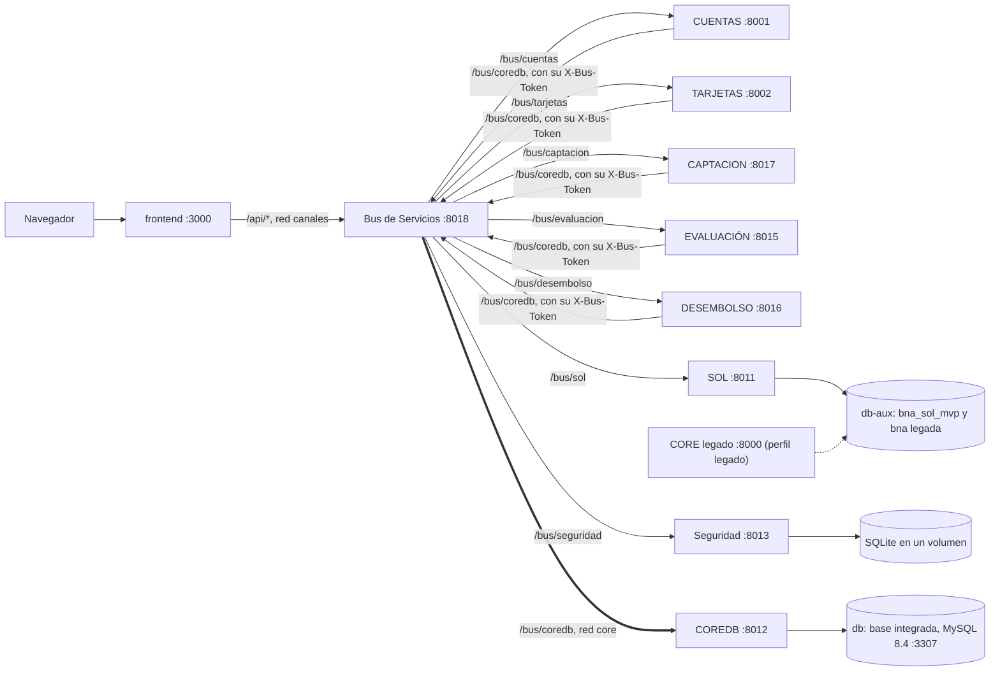
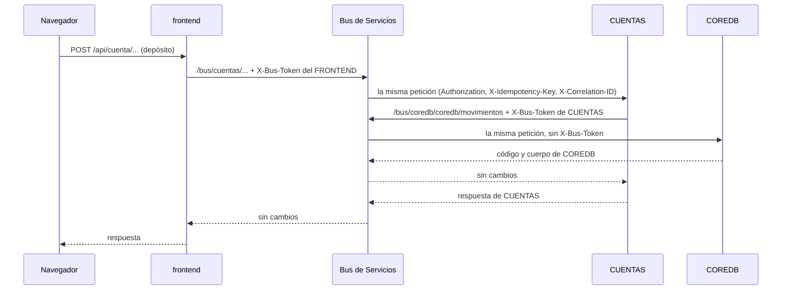

# Banco Nacional de Arequipa (BNA)

Sistema bancario modular, proyecto académico de la UCSM (2026). Este repositorio contiene el producto integrado: la base de datos del CORE, su API, los módulos que ya trabajan sobre ella y el frontend. Todo se levanta en Docker con una orden.

| Parte | Carpeta | Qué hace | Estado |
|---|---|---|---|
| Base integrada | `database/` | MySQL 8.4 con el esquema del CORE: clientes, cuentas, movimientos, tarjetas, contabilidad y bitácora | En uso |
| COREDB | `backend/COREDB` | La API del CORE. Es el único servicio que se conecta a la base integrada | En uso |
| Bus de Servicios | `backend/BUS_SERVICIOS` | Punto único por el que el frontend llega a los módulos y los módulos llegan a COREDB: `/bus/<módulo>/<ruta>` se reenvía sin tocar cabeceras, cuerpo ni códigos, con una credencial por consumidor | En uso |
| CUENTAS | `backend/CUENTAS` | Cuentas de ahorro: apertura, depósito, retiro, transferencia y consultas. No tiene base propia: llama a COREDB | En uso |
| TARJETAS | `backend/TARJETAS` | Tarjetas de débito: emisión, consulta, bloqueo y cambio de estado. No tiene base propia: llama a COREDB | En uso |
| ATM | `backend/ATM` | Cajero automático: pantalla, validar PIN, autorizar retención, dispensar, confirmar (idempotente), extorno, consultar saldo/movimientos. Sin base propia: llama a TARJETAS y CUENTAS por el Bus | En uso |
| CAPTACION | `backend/CAPTACION` | Captación de clientes: registro del solicitante, consentimientos, OTP, RENIEC/listas/PEP, centrales y perfil de riesgo; registra al cliente HABILITADO en COREDB y publica la referencia CR-INT-01 que consulta SOL. Sin base propia: el expediente vive en la base integrada (`clientes.*_captacion`) y se trabaja por COREDB | En uso, con proveedores simulados |
| Frontend | `frontend/` | Banca personal en Next.js: inicio de sesión, cuentas, tarjetas, captación y solicitud de crédito; pantallas del analista (`/evaluacion`) y del operador de desembolso (`/desembolso`) | En uso |
| SOL | `backend/SOL` | Solicitud de crédito, con Captación y Evaluación simuladas | Laboratorio: base propia, sin conexión con el CORE |
| EVALUACIÓN | `backend/EVALUACION` | Evaluación crediticia: recibe el expediente de SOL y lo registra en COREDB; el analista evalúa con la regla provisional y decide los casos observados. La aprobación queda en COREDB para Desembolso, con el calendario de SOL | En uso: sin base propia, llama a COREDB |
| DESEMBOLSO | `backend/DESEMBOLSO` | Desembolso de créditos: el operador verifica el documento del titular, prepara la orden con una aprobación y una cuenta individual, y confirma; COREDB abona una sola vez, crea el crédito con su calendario oficial y deja la solicitud desembolsada | En uso: sin base propia, llama a COREDB |
| Seguridad | `backend/seguridad` | Prototipo de login, topes, auditoría encadenada e incidentes | Laboratorio: SQLite, sin conexión con el CORE |
| CORE legado | `backend/CORE` | La API anterior, sobre el esquema `bna`. Tiene su propia evaluación de créditos; COREDB ya ofrece la evaluación, el desembolso y la cobranza sobre la base integrada | Opcional: ningún servicio lo llama |

Para contribuir, ver [`CONTRIBUTING.md`](CONTRIBUTING.md): rama, PR y CI en verde; nada directo a `main`.

Lo que no está: el módulo Clientes (en revisión en el PR #25). Todo pasa por el Bus de Servicios, como pide [`Documents/01-stack-tecnologico.md`](Documents/01-stack-tecnologico.md): el frontend llega a los módulos a través de él, y los módulos llegan a COREDB también a través de él.

## Requisitos

- Docker con Compose 2.20 o superior, en marcha (`docker compose version`, `docker info`).
- Git y bash. En Windows, Git Bash o WSL2.
- Libres en la máquina: los puertos 3000, 3307, 8001, 8002, 8011, 8012, 8013, 8015, 8016, 8017 y 8018, y unos 4 GB de disco para las imágenes.

No hace falta Python, Node ni MySQL: todo corre en contenedores.

## Inicio rápido

```bash
git clone https://github.com/SantiagoCusirramos/Banco_Nacional_Arequipa.git
cd Banco_Nacional_Arequipa
./bna up                          # o: make up
./bna smoke                       # comprueba el producto de extremo a extremo
grep BNA_ADMIN_PASSWORD .env      # la contraseña del administrador
```

Después, abrir http://localhost:3000 y entrar con el usuario `admin` y esa contraseña.

`./bna up` crea `.env` con claves aleatorias (no se versiona), construye las imágenes, levanta los servicios y espera a que todos estén sanos. La primera vez tarda varios minutos, porque descarga las imágenes base y las dependencias. Al terminar muestra las direcciones.

## Arquitectura



Camino de una llamada, por ejemplo un depósito desde el frontend:



- El navegador solo habla con el frontend. Sus rutas `/api/core`, `/api/cuenta`, `/api/tarjeta`, `/api/captacion`, `/api/solicitud-credito`, `/api/evaluacion` y `/api/desembolso` reenvían cada petición desde el servidor de Next.js al Bus de Servicios, así que el navegador nunca conoce la dirección de un servicio.
- Los módulos que usan COREDB (CUENTAS, TARJETAS, CAPTACION, Evaluación y Desembolso) también llegan a él a través del Bus: su dirección de COREDB es `http://bus:8018/bus/coredb` y presentan su propia credencial (`BUS_TOKEN`, un consumidor del Bus por módulo).
- El Bus reenvía cada petición sin tocarla (Authorization, X-Idempotency-Key, X-Correlation-ID, cuerpo y código de vuelta), quita solo su propia credencial y nunca reintenta: un reintento con llave de idempotencia lo decide el módulo. Si el destino no responde, contesta 503 o 504 con un error claro. Ver [`backend/BUS_SERVICIOS/README.md`](backend/BUS_SERVICIOS/README.md).
- En compose hay dos redes cerradas: `canales` (el frontend y el Bus: el frontend no ve los módulos) y `core` (la base, COREDB, `coredb-init` y el Bus: los módulos no ven COREDB). `scripts/comprobar_rutas_coredb.py`, que corre en `./bna test`, falla si algún módulo de compose, k8s, los `.env.example` o los valores por omisión tiene la dirección directa de COREDB. Solo la tienen el Bus (`BUS_URL_COREDB`; en k8s, el ConfigMap `bna-bus`, que solo lee el Bus), COREDB mismo y su arranque (`coredb-init` y los contenedores de arranque del Deployment `coredb`, que crean los usuarios iniciales conectados a la base). Las suites de integración de los módulos también levantan un Bus (`scripts/bus_de_pruebas.sh`).
- SOL tiene base propia y, mientras siga en modo SIMULADO, no llama a CAPTACION ni a Evaluación; cuando pase a REAL, esas llamadas irán también por el Bus.
- COREDB es la única entrada a la base integrada, y escribe en ella solo por procedimientos almacenados.
- `db-aux` es otro MySQL, con la base de SOL (`bna_sol_mvp`) y el esquema `bna` del CORE legado. La base integrada no recibe esquemas ni usuarios ajenos.
- Todos los puertos se publican solo en `127.0.0.1`.

## Servicios y puertos

| Servicio | Dirección | Cómo entrar | Documentación |
|---|---|---|---|
| Frontend | http://localhost:3000 | `admin` y `BNA_ADMIN_PASSWORD` | [`frontend/README.md`](frontend/README.md) |
| Captación de clientes | http://localhost:3000/captacion | `admin` y `BNA_ADMIN_PASSWORD` (o un usuario ASESOR) | [`backend/CAPTACION/README.md`](backend/CAPTACION/README.md) |
| Solicitud de crédito | http://localhost:3000/solicitud-credito | `asesor.bna`, `supervisor.bna`, `auditor.bna` o `evaluador.demo`, con `SOL_INITIAL_PASSWORD` | [`EMPEZAR_AQUI_SOL.md`](EMPEZAR_AQUI_SOL.md) |
| Bus de Servicios | http://127.0.0.1:8018/docs | Credencial del consumidor en `X-Bus-Token` (`BUS_TOKEN_*` en `.env`), más la del módulo | [`backend/BUS_SERVICIOS/README.md`](backend/BUS_SERVICIOS/README.md) |
| COREDB | http://127.0.0.1:8012/docs | Token de `POST /coredb/auth/login` con `admin` | [`backend/COREDB/README.md`](backend/COREDB/README.md) |
| CUENTAS | http://127.0.0.1:8001/docs | El mismo token de COREDB | [`backend/CUENTAS/README.md`](backend/CUENTAS/README.md) |
| TARJETAS | http://127.0.0.1:8002/docs | El mismo token de COREDB | [`backend/TARJETAS/README.md`](backend/TARJETAS/README.md) |
| ATM | http://127.0.0.1:8019 (pantalla) / http://127.0.0.1:8019/docs (API) | El mismo token de COREDB | [`backend/ATM/README.md`](backend/ATM/README.md) |
| CAPTACION | http://127.0.0.1:8017/docs | El mismo token de COREDB | [`backend/CAPTACION/README.md`](backend/CAPTACION/README.md) |
| SOL | http://127.0.0.1:8011/docs | Las cuentas de la solicitud de crédito | [`EMPEZAR_AQUI_SOL.md`](EMPEZAR_AQUI_SOL.md) |
| Evaluación | http://localhost:3000/evaluacion (API: http://127.0.0.1:8015/docs) | Un usuario de COREDB con rol ANALISTA (decidir exige además un analista registrado: el administrador lo da de alta con `POST /coredb/empleados` y `POST /coredb/creditos/analistas`); AUDITOR solo consulta | [`backend/EVALUACION/README.md`](backend/EVALUACION/README.md) |
| Desembolso | http://localhost:3000/desembolso (API: http://127.0.0.1:8016/docs) | Un usuario de COREDB con rol OPERADOR; ADMINISTRADOR hace de supervisor y AUDITOR consulta | [`backend/DESEMBOLSO/README.md`](backend/DESEMBOLSO/README.md) |
| Seguridad | http://127.0.0.1:8013 | No trae usuarios: se crean con una orden | [`backend/seguridad/README.md`](backend/seguridad/README.md) |
| MySQL de la base integrada | `127.0.0.1:3307` | `root` y `CORE_DB_ROOT_PASSWORD` | [`database/README.md`](database/README.md) |
| CORE legado (opcional) | http://127.0.0.1:8000/docs | Token de `POST /core/auth/login` | [`backend/CORE/README.md`](backend/CORE/README.md) |

Las contraseñas están en `.env`. `db-aux` no publica ningún puerto. Sin un cliente de MySQL en la máquina, la base integrada se abre con `docker compose exec db mysql -uroot -p`.

El CORE legado solo se levanta si se pide: `COMPOSE_PROFILES=legado ./bna up`. Todas sus rutas salvo el login exigen token y permiso. `./bna down` y `./bna reset` lo detienen también; con `docker compose` directo hay que nombrar su perfil: `docker compose --profile legado down`.

## Órdenes

| Orden | Qué hace |
|---|---|
| `./bna up` | Crea `.env` si falta, construye, levanta todo y espera a que esté sano |
| `./bna down` | Detiene y elimina los contenedores; conserva los datos |
| `./bna reset` | Elimina también los datos y vuelve a levantar desde cero |
| `./bna ps` | Estado de los servicios |
| `./bna logs [servicio]` | Registros en vivo |
| `./bna smoke` | Flujo de extremo a extremo contra el producto levantado |
| `./bna test` | Todas las suites de pruebas, en contenedores, y el flujo |
| `./bna k8s-up`, `k8s-smoke`, `k8s-ps`, `k8s-down` | Lo mismo en un clúster local de Kubernetes |

Con make: `make up`, `make test`, etc. Para quitar todo, datos incluidos: `docker compose down -v`.

## Configuración

Toda la configuración del producto está en `.env`, en la raíz. `./bna up` lo crea a partir de [`.env.example`](.env.example): pone un valor aleatorio en cada clave vacía y nunca cambia un valor que ya existe.

| Variables | Para qué |
|---|---|
| `BNA_ADMIN_USUARIO`, `BNA_ADMIN_PASSWORD` | Primer administrador de COREDB. Se crea al arrancar si no hay ninguno |
| `CORE_DB_*_PASSWORD` | Usuarios de la base integrada |
| `CORE_DB_JWT_CLAVE` | Clave que firma los tokens de COREDB |
| `SOL_INITIAL_PASSWORD` | Clave inicial de las cuatro cuentas de demostración de SOL |
| `SEGURIDAD_SECRET_KEY` | Clave del módulo de Seguridad |
| `AUX_DB_ROOT_PASSWORD`, `SOL_DB_PASSWORD`, `LEGADO_DB_PASSWORD`, `LEGADO_SECRET_KEY` | Base auxiliar y CORE legado |
| `EVALUACION_COREDB_SECRETO`, `EVALUACION_TOKEN_SOL`, `EVALUACION_SOL_TOKEN_RESULTADOS` | Secreto del usuario de servicio de Evaluación en COREDB y los tokens de CR-INT-02 y CR-INT-03 con SOL |
| `DESEMBOLSO_COREDB_SECRETO` | Secreto del usuario de servicio de Desembolso en COREDB |
| `BUS_TOKEN_FRONTEND`, `BUS_TOKEN_PRUEBAS`, `BUS_TOKEN_CUENTAS`, `BUS_TOKEN_TARJETAS`, `BUS_TOKEN_CAPTACION`, `BUS_TOKEN_EVALUACION`, `BUS_TOKEN_DESEMBOLSO`, `BUS_TOKEN_ATM` | Bus de Servicios: credencial de los puentes del frontend, del flujo de extremo a extremo y de cada módulo que llama a COREDB (incluye ATM) |
| `CAPTACION_COREDB_SECRETO`, `CAP_SOL_TOKEN`, `CAP_OTP_CLAVE` | CAPTACION: secreto de su usuario de servicio en COREDB, el token con el que SOL consulta las referencias y la clave de los OTP |
| `BNA_PUERTO_*` | Puerto de cada servicio en esta máquina (incluye `BNA_PUERTO_ATM=8019`) |

- Para usar otro puerto, cambiar su `BNA_PUERTO_*` en `.env` y volver a ejecutar `./bna up`.
- Las contraseñas de las bases y las cuentas iniciales solo se aplican al crear los datos. Para que un cambio en `.env` surta efecto en ellas: `./bna reset`, que borra los datos.
- `.env` no se versiona. La CI falla si aparece un archivo de claves en el repositorio.

Los archivos `.env.example` dentro de `backend/` y `frontend/` sirven para ejecutar un módulo suelto, fuera de Docker. Cada README de módulo dice cómo.

## Pruebas

```bash
./bna test
```

Corre, en contenedores, las suites del CORE legado (unitarias y contra un MySQL nuevo), CUENTAS, TARJETAS, el Bus de Servicios (y la comprobación de que ningún módulo tiene la dirección directa de COREDB), SOL, Evaluación, Desembolso y CAPTACION (contra COREDB y la base integrada nuevas, a través de un Bus de pruebas; CAPTACION también con el adaptador real de SOL), Seguridad y COREDB (unitarias y contra un MySQL nuevo), el despliegue de la base integrada, el aviso de push directo, el lint y las pruebas del frontend, y al final levanta el producto y ejecuta el flujo de `./bna smoke`. Termina con un resumen por suite y con un código de salida distinto de cero si alguna falla.

Si el producto no estaba levantado, `./bna test` elimina al terminar los contenedores y volúmenes que creó. Si ya estaba levantado, lo deja en marcha con sus datos.

`./bna smoke` inicia sesión como administrador, registra un cliente, le abre dos cuentas, deposita, transfiere, repite la transferencia para comprobar la idempotencia y lee saldos, movimientos y bitácora por COREDB; después consulta las mismas cuentas por CUENTAS; por TARJETAS emite una tarjeta al cliente de desarrollo `DEV001`, la activa, la bloquea y comprueba que el desbloqueo se rechaza; por CAPTACION capta a un prospecto hasta habilitarlo, comprueba el cliente en COREDB y la referencia CR-INT-01 que leería SOL; y al final llega a los servicios por los puentes del frontend. Todo pasa por el Bus de Servicios: el flujo corre en su contenedor, solo conoce la dirección del Bus y la del frontend, y termina comprobando con las métricas del Bus que el flujo y los siete puentes del frontend llegaron a los módulos a través de él, y que CUENTAS, TARJETAS, CAPTACION, Evaluación y Desembolso llegaron a COREDB por él. Cada ejecución crea un cliente nuevo y una tarjeta nueva.

La CI (`.github/workflows/ci.yml`) ejecuta `./bna test` en cada PR y en cada push a `main`. Un segundo flujo (`k8s.yml`) despliega el producto en un clúster de kind cuando cambia algo del despliegue o del flujo de extremo a extremo (`scripts/flujo_e2e.py`). Un tercero (`aviso-push-directo.yml`) abre un issue para el autor de cada commit que llega a `main` sin un PR fusionado.

## Kubernetes

Con Docker, `kind` y `kubectl` instalados:

```bash
./bna k8s-up       # crea el clúster, carga las imágenes y despliega
./bna k8s-smoke    # el mismo flujo de extremo a extremo, dentro del clúster
./bna k8s-down     # elimina el clúster
```

Usa puertos distintos de los de `./bna up` (frontend en http://localhost:13000). Los manifiestos, las claves y los problemas conocidos están en [`k8s/README.md`](k8s/README.md).

## Si algo falla

| Síntoma | Qué hacer |
|---|---|
| `Docker no responde` | Iniciar Docker (Docker Desktop, o `sudo systemctl start docker` en Linux) |
| `permission denied` al conectar con Docker, en Linux | Agregar el usuario al grupo `docker` y volver a iniciar sesión |
| `port is already allocated` o `address already in use` | Otro programa usa ese puerto. Cambiar el `BNA_PUERTO_*` correspondiente en `.env` y repetir `./bna up` |
| `Tras 600 s siguen sin estar sanos: ...` | Ver por qué con `./bna logs <servicio>`. En una máquina lenta, dar más tiempo: `BNA_ESPERA_SEGUNDOS=1200 ./bna up` |
| `El servicio ... se detuvo` | El mensaje trae el final de sus registros. El resto, con `./bna logs <servicio>` |
| `Falta en .env. Ejecute ./bna up` | Se llamó a `docker compose` sin `.env`. `./bna up` lo crea |
| El administrador no puede entrar | La contraseña es la de `BNA_ADMIN_PASSWORD` en `.env`. Si se cambió después del primer arranque no se aplicó: `./bna reset` |
| Tras actualizar el repositorio, COREDB no arranca o una ruta responde 500 | La base se carga solo sobre un volumen vacío, así que un esquema nuevo no llega a una base ya creada: `./bna reset` |
| Un movimiento se rechaza por falta de periodo contable | Los datos de desarrollo traen periodos para 24 meses desde que se creó la base. Pasado ese plazo: `./bna reset` |
| Quedó algo a medias | `docker compose down -v` y `./bna up` |

## Estructura del repositorio

```
├── bna, Makefile      Órdenes del producto
├── compose.yaml       Los servicios y cómo se conectan
├── .env.example       Variables del producto
├── docker/            Dockerfiles de cada imagen
├── scripts/           Lo que ejecuta ./bna: claves, pruebas, flujo y Kubernetes
├── k8s/               Manifiestos de Kubernetes
├── database/          Base integrada. Copia de bna-core-db: no se edita aquí
├── backend/
│   ├── COREDB/        API del CORE
│   ├── BUS_SERVICIOS/ Bus de Servicios
│   ├── CUENTAS/       Módulo de cuentas de ahorro
│   ├── TARJETAS/      Módulo de tarjetas de débito
│   ├── ATM/           Módulo de cajero automático
│   ├── CAPTACION/     Módulo de captación de clientes
│   ├── SOL/           Solicitud de crédito
│   ├── EVALUACION/    Evaluación crediticia
│   ├── DESEMBOLSO/    Desembolso de créditos
│   ├── seguridad/     Prototipo de Seguridad
│   ├── CORE/          CORE legado
│   └── Infraestructura - BD/   Esquema `bna` del CORE legado
├── frontend/          Next.js
└── Documents/         Stack, registros de validación y documentos de SOL
```

## Documentación

- Por módulo: los README enlazados en [Servicios y puertos](#servicios-y-puertos).
- Contrato de COREDB para el módulo Clientes: [`backend/COREDB/CONTRATO_CLIENTES.md`](backend/COREDB/CONTRATO_CLIENTES.md).
- Contrato de COREDB para la línea de créditos (Evaluación, Desembolso y Cobranza): [`backend/COREDB/CONTRATO_CREDITOS.md`](backend/COREDB/CONTRATO_CREDITOS.md).
- Cómo se actualiza `database/`: [`database/README-UPSTREAM.md`](database/README-UPSTREAM.md).
- Autenticación del CORE legado: [`backend/CORE/AUTH_JWT.md`](backend/CORE/AUTH_JWT.md) y [`backend/CORE/AUTENTICACION.md`](backend/CORE/AUTENTICACION.md).
- Seguimiento de los hallazgos del CORE legado: [`Documents/08-seguimiento-hallazgos.md`](Documents/08-seguimiento-hallazgos.md).
- Stack previsto y decisiones de arquitectura: [`Documents/01-stack-tecnologico.md`](Documents/01-stack-tecnologico.md). Describe el diseño completo; lo que hay hoy es lo de este README (el frontend y los módulos llegan a los demás servicios a través del Bus).

## Convenciones

- Los montos son `DECIMAL(15,2)` en la base y texto decimal (`"500.00"`) en las API. Nunca `float`.
- Las monedas siguen ISO 4217: `PEN` y `USD`.
- El navegador no llama a ningún servicio: todo pasa por el frontend.
- `X-Correlation-ID` identifica una petición de punta a punta. El frontend lo genera si falta, CUENTAS y TARJETAS lo reenvían a COREDB, COREDB lo devuelve siempre y lo guarda en la bitácora, y Seguridad lo exige.
- Un cambio en la base va primero a [bna-core-db](https://github.com/miguelpro324/bna-core-db) y llega aquí con una etiqueta nueva. `database/` no se edita.
- Ninguna clave se versiona.
- Todo cambio llega a `main` por un PR: [`CONTRIBUTING.md`](CONTRIBUTING.md).

## Equipo

Proyecto académico de la Universidad Católica de Santa María (UCSM), 2026.
