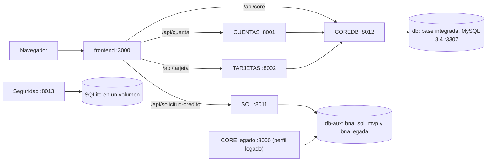

# Banco Nacional de Arequipa (BNA)

Sistema bancario modular, proyecto académico de la UCSM (2026). Este repositorio contiene el producto integrado: la base de datos del CORE, su API, los módulos que ya trabajan sobre ella y el frontend. Todo se levanta en Docker con una orden.

| Parte | Carpeta | Qué hace | Estado |
|---|---|---|---|
| Base integrada | `database/` | MySQL 8.4 con el esquema del CORE: clientes, cuentas, movimientos, tarjetas, contabilidad y bitácora | En uso |
| COREDB | `backend/COREDB` | La API del CORE. Es el único servicio que se conecta a la base integrada | En uso |
| CUENTAS | `backend/CUENTAS` | Cuentas de ahorro: apertura, depósito, retiro, transferencia y consultas. No tiene base propia: llama a COREDB | En uso |
| TARJETAS | `backend/TARJETAS` | Tarjetas de débito: emisión, consulta, bloqueo y cambio de estado. No tiene base propia: llama a COREDB | En uso |
| Frontend | `frontend/` | Banca personal en Next.js: inicio de sesión, cuentas, tarjetas y solicitud de crédito | En uso |
| SOL | `backend/SOL` | Solicitud de crédito, con Captación y Evaluación simuladas | Laboratorio: base propia, sin conexión con el CORE |
| Seguridad | `backend/seguridad` | Prototipo de login, topes, auditoría encadenada e incidentes | Laboratorio: SQLite, sin conexión con el CORE |
| CORE legado | `backend/CORE` | La API anterior, sobre el esquema `bna`. Tiene los créditos, que COREDB todavía no ofrece | Opcional: ningún servicio lo llama |

Lo que no está: el módulo Clientes (en revisión en el PR #25) y el Bus de Servicios, que no existe todavía. Los servicios se llaman entre sí directamente dentro de la red de Docker.

## Requisitos

- Docker con Compose 2.20 o superior, en marcha (`docker compose version`, `docker info`).
- Git y bash. En Windows, Git Bash o WSL2.
- Libres en la máquina: los puertos 3000, 3307, 8001, 8002, 8011, 8012 y 8013, y unos 4 GB de disco para las imágenes.

No hace falta Python, Node ni MySQL: todo corre en contenedores.

## Inicio rápido

```bash
git clone https://github.com/SantiagoCusirramos/Banco_Nacional_Arequipa.git
cd Banco_Nacional_Arequipa
./bna up                          # o: make up
./bna smoke                       # comprueba el producto de extremo a extremo
grep BNA_ADMIN_PASSWORD .env      # la contraseña del administrador
```

Después, abrir http://localhost:3000 y entrar con el usuario `admin` y esa contraseña.

`./bna up` crea `.env` con claves aleatorias (no se versiona), construye las imágenes, levanta los servicios y espera a que todos estén sanos. La primera vez tarda varios minutos, porque descarga las imágenes base y las dependencias. Al terminar muestra las direcciones.

## Arquitectura



- El navegador solo habla con el frontend. Sus rutas `/api/core`, `/api/cuenta`, `/api/tarjeta` y `/api/solicitud-credito` reenvían cada petición desde el servidor de Next.js, así que el navegador nunca conoce la dirección de un servicio.
- COREDB es la única entrada a la base integrada, y escribe en ella solo por procedimientos almacenados.
- `db-aux` es otro MySQL, con la base de SOL (`bna_sol_mvp`) y el esquema `bna` del CORE legado. La base integrada no recibe esquemas ni usuarios ajenos.
- Todos los puertos se publican solo en `127.0.0.1`.

## Servicios y puertos

| Servicio | Dirección | Cómo entrar | Documentación |
|---|---|---|---|
| Frontend | http://localhost:3000 | `admin` y `BNA_ADMIN_PASSWORD` | [`frontend/README.md`](frontend/README.md) |
| Solicitud de crédito | http://localhost:3000/solicitud-credito | `asesor.bna`, `supervisor.bna`, `auditor.bna` o `evaluador.demo`, con `SOL_INITIAL_PASSWORD` | [`EMPEZAR_AQUI_SOL.md`](EMPEZAR_AQUI_SOL.md) |
| COREDB | http://127.0.0.1:8012/docs | Token de `POST /coredb/auth/login` con `admin` | [`backend/COREDB/README.md`](backend/COREDB/README.md) |
| CUENTAS | http://127.0.0.1:8001/docs | El mismo token de COREDB | [`backend/CUENTAS/README.md`](backend/CUENTAS/README.md) |
| TARJETAS | http://127.0.0.1:8002/docs | El mismo token de COREDB | [`backend/TARJETAS/README.md`](backend/TARJETAS/README.md) |
| SOL | http://127.0.0.1:8011/docs | Las cuentas de la solicitud de crédito | [`EMPEZAR_AQUI_SOL.md`](EMPEZAR_AQUI_SOL.md) |
| Seguridad | http://127.0.0.1:8013 | No trae usuarios: se crean con una orden | [`backend/seguridad/README.md`](backend/seguridad/README.md) |
| MySQL de la base integrada | `127.0.0.1:3307` | `root` y `CORE_DB_ROOT_PASSWORD` | [`database/README.md`](database/README.md) |
| CORE legado (opcional) | http://127.0.0.1:8000/docs | Token de `POST /core/auth/login` | [`backend/CORE/README.md`](backend/CORE/README.md) |

Las contraseñas están en `.env`. `db-aux` no publica ningún puerto.

El CORE legado solo se levanta si se pide: `COMPOSE_PROFILES=legado ./bna up`. Todas sus rutas salvo el login exigen token y permiso.

## Órdenes

| Orden | Qué hace |
|---|---|
| `./bna up` | Crea `.env` si falta, construye, levanta todo y espera a que esté sano |
| `./bna down` | Detiene y elimina los contenedores; conserva los datos |
| `./bna reset` | Elimina también los datos y vuelve a levantar desde cero |
| `./bna ps` | Estado de los servicios |
| `./bna logs [servicio]` | Registros en vivo |
| `./bna smoke` | Flujo de extremo a extremo contra el producto levantado |
| `./bna test` | Todas las suites de pruebas, en contenedores, y el flujo |
| `./bna k8s-up`, `k8s-smoke`, `k8s-ps`, `k8s-down` | Lo mismo en un clúster local de Kubernetes |

Con make: `make up`, `make test`, etc. Para quitar todo, datos incluidos: `docker compose down -v`.

## Configuración

Toda la configuración del producto está en `.env`, en la raíz. `./bna up` lo crea a partir de [`.env.example`](.env.example): pone un valor aleatorio en cada clave vacía y nunca cambia un valor que ya existe.

| Variables | Para qué |
|---|---|
| `BNA_ADMIN_USUARIO`, `BNA_ADMIN_PASSWORD` | Primer administrador de COREDB. Se crea al arrancar si no hay ninguno |
| `CORE_DB_*_PASSWORD` | Usuarios de la base integrada |
| `CORE_DB_JWT_CLAVE` | Clave que firma los tokens de COREDB |
| `SOL_INITIAL_PASSWORD` | Clave inicial de las cuatro cuentas de demostración de SOL |
| `SEGURIDAD_SECRET_KEY` | Clave del módulo de Seguridad |
| `AUX_DB_ROOT_PASSWORD`, `SOL_DB_PASSWORD`, `LEGADO_DB_PASSWORD`, `LEGADO_SECRET_KEY` | Base auxiliar y CORE legado |
| `BNA_PUERTO_*` | Puerto de cada servicio en esta máquina |

- Para usar otro puerto, cambiar su `BNA_PUERTO_*` en `.env` y volver a ejecutar `./bna up`.
- Las contraseñas de las bases y las cuentas iniciales solo se aplican al crear los datos. Para que un cambio en `.env` surta efecto en ellas: `./bna reset`, que borra los datos.
- `.env` no se versiona. La CI falla si aparece un archivo de claves en el repositorio.

Los archivos `.env.example` dentro de `backend/` y `frontend/` sirven para ejecutar un módulo suelto, fuera de Docker. Cada README de módulo dice cómo.

## Pruebas

```bash
./bna test
```

Corre, en contenedores, las suites del CORE legado, CUENTAS, TARJETAS, SOL, Seguridad y COREDB (unitarias y contra un MySQL nuevo), el despliegue de la base integrada, el lint y las pruebas del frontend, y al final levanta el producto y ejecuta el flujo de `./bna smoke`. Termina con un resumen por suite y con un código de salida distinto de cero si alguna falla.

Si el producto no estaba levantado, `./bna test` elimina al terminar los contenedores y volúmenes que creó. Si ya estaba levantado, lo deja en marcha con sus datos.

`./bna smoke` inicia sesión como administrador, registra un cliente, le abre dos cuentas, deposita, transfiere, repite la transferencia para comprobar la idempotencia y lee saldos, movimientos y bitácora por COREDB; después consulta las mismas cuentas por CUENTAS; por TARJETAS emite una tarjeta al cliente de desarrollo `DEV001`, la activa, la bloquea y comprueba que el desbloqueo se rechaza; y al final llega a los tres servicios por los puentes del frontend. Cada ejecución crea un cliente nuevo y una tarjeta nueva.

La CI (`.github/workflows/ci.yml`) ejecuta `./bna test` en cada PR y en cada push a `main`. Un segundo flujo (`k8s.yml`) despliega el producto en un clúster de kind cuando cambia algo del despliegue.

## Kubernetes

Con Docker, `kind` y `kubectl` instalados:

```bash
./bna k8s-up       # crea el clúster, carga las imágenes y despliega
./bna k8s-smoke    # el mismo flujo de extremo a extremo, dentro del clúster
./bna k8s-down     # elimina el clúster
```

Usa puertos distintos de los de `./bna up` (frontend en http://localhost:13000). Los manifiestos, las claves y los problemas conocidos están en [`k8s/README.md`](k8s/README.md).

## Si algo falla

| Síntoma | Qué hacer |
|---|---|
| `Docker no responde` | Iniciar Docker (Docker Desktop, o `sudo systemctl start docker` en Linux) |
| `permission denied` al conectar con Docker, en Linux | Agregar el usuario al grupo `docker` y volver a iniciar sesión |
| `port is already allocated` o `address already in use` | Otro programa usa ese puerto. Cambiar el `BNA_PUERTO_*` correspondiente en `.env` y repetir `./bna up` |
| `Tras 600 s siguen sin estar sanos: ...` | Ver por qué con `./bna logs <servicio>`. En una máquina lenta, dar más tiempo: `BNA_ESPERA_SEGUNDOS=1200 ./bna up` |
| `El servicio ... se detuvo` | El mensaje trae el final de sus registros. El resto, con `./bna logs <servicio>` |
| `Falta en .env. Ejecute ./bna up` | Se llamó a `docker compose` sin `.env`. `./bna up` lo crea |
| El administrador no puede entrar | La contraseña es la de `BNA_ADMIN_PASSWORD` en `.env`. Si se cambió después del primer arranque no se aplicó: `./bna reset` |
| Tras actualizar el repositorio, COREDB no arranca o una ruta responde 500 | La base se carga solo sobre un volumen vacío, así que un esquema nuevo no llega a una base ya creada: `./bna reset` |
| Un movimiento se rechaza por falta de periodo contable | Los datos de desarrollo traen periodos para 24 meses desde que se creó la base. Pasado ese plazo: `./bna reset` |
| Quedó algo a medias | `docker compose down -v` y `./bna up` |

## Estructura del repositorio

```
├── bna, Makefile      Órdenes del producto
├── compose.yaml       Los servicios y cómo se conectan
├── .env.example       Variables del producto
├── docker/            Dockerfiles de cada imagen
├── scripts/           Lo que ejecuta ./bna: claves, pruebas, flujo y Kubernetes
├── k8s/               Manifiestos de Kubernetes
├── database/          Base integrada. Copia de bna-core-db: no se edita aquí
├── backend/
│   ├── COREDB/        API del CORE
│   ├── CUENTAS/       Módulo de cuentas de ahorro
│   ├── TARJETAS/      Módulo de tarjetas de débito
│   ├── SOL/           Solicitud de crédito
│   ├── seguridad/     Prototipo de Seguridad
│   ├── CORE/          CORE legado
│   └── Infraestructura - BD/   Esquema `bna` del CORE legado
├── frontend/          Next.js
└── Documents/         Stack, registros de validación y documentos de SOL
```

## Documentación

- Por módulo: los README enlazados en [Servicios y puertos](#servicios-y-puertos).
- Contrato de COREDB para el módulo Clientes: [`backend/COREDB/CONTRATO_CLIENTES.md`](backend/COREDB/CONTRATO_CLIENTES.md).
- Cómo se actualiza `database/`: [`database/README-UPSTREAM.md`](database/README-UPSTREAM.md).
- Autenticación del CORE legado: [`backend/CORE/AUTH_JWT.md`](backend/CORE/AUTH_JWT.md) y [`backend/CORE/AUTENTICACION.md`](backend/CORE/AUTENTICACION.md).
- Seguimiento de los hallazgos del CORE legado: [`Documents/08-seguimiento-hallazgos.md`](Documents/08-seguimiento-hallazgos.md).
- Stack previsto y decisiones de arquitectura: [`Documents/01-stack-tecnologico.md`](Documents/01-stack-tecnologico.md). Describe el diseño completo, con el Bus de Servicios; lo que hay hoy es lo de este README.

## Convenciones

- Los montos son `DECIMAL(15,2)` en la base y texto decimal (`"500.00"`) en las API. Nunca `float`.
- Las monedas siguen ISO 4217: `PEN` y `USD`.
- El navegador no llama a ningún servicio: todo pasa por el frontend.
- `X-Correlation-ID` identifica una petición de punta a punta. El frontend lo genera si falta, CUENTAS y TARJETAS lo reenvían a COREDB, COREDB lo devuelve siempre y lo guarda en la bitácora, y Seguridad lo exige.
- Un cambio en la base va primero a [bna-core-db](https://github.com/miguelpro324/bna-core-db) y llega aquí con una etiqueta nueva. `database/` no se edita.
- Ninguna clave se versiona.

## Equipo

Proyecto académico de la Universidad Católica de Santa María (UCSM), 2026.
