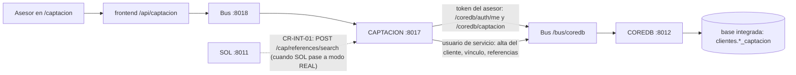

# CAPTACION

Módulo de Captación de Clientes. Lleva a una persona desde que pide un producto hasta que queda
**habilitada** como cliente del banco, con su identidad verificada:

1. **Registro** del solicitante (prospecto) y apertura de su **caso**.
2. **Consentimientos**: tratamiento de datos, consulta a centrales y términos (biometría, opcional).
3. **Verificación de datos**: código OTP al celular (y al correo, opcional); RENIEC, listas
   restrictivas y PEP; validaciones manuales para la debida diligencia.
4. **Centrales de riesgo** (SBS, Infocorp, Sentinel, Equifax) y **perfil** de riesgo de 0 a 1000.
5. **Habilitación**: registra al cliente en **COREDB** como `HABILITADO` (o reutiliza el cliente
   activo que ya tenga ese documento), lo liga al caso y deja la **referencia vigente** que
   consulta **Solicitud de Crédito** (contrato CR-INT-01). La base le anota las verificaciones de
   celular y correo.

**No tiene base propia**: el expediente vive en la base integrada, en las tablas de extensión
`clientes.*_captacion` (desde `bd-v1.7-mysql`), y se trabaja por `/coredb/captacion`. La base
guarda cada paso, aplica las reglas del expediente y recalcula el estado.

Puerto **8017**. Pantalla del asesor: **http://localhost:3000/captacion**.

## Cómo se integra



| Con | Cómo | Qué |
|---|---|---|
| **COREDB / expediente** | Token JWT del asesor | `GET /coredb/auth/me` (quién es y sus permisos) y `/coredb/captacion/...`: solicitante, caso, consentimientos, OTP, validaciones, centrales, perfil, estado y habilitación. Leer exige `VER_CLIENTE`; trabajar un caso, `CREAR_CLIENTE` (ASESOR y ADMINISTRADOR). Cada paso queda a nombre del asesor en la bitácora de la base |
| **COREDB / Clientes** | Usuario de servicio `svc-captacion` (rol SERVICIO, módulo CLIENTES) | `POST /coredb/clientes/validaciones/documento` (¿ya es cliente?), `POST /coredb/clientes` (alta HABILITADA), `POST /coredb/captacion/casos/{id}/cliente` (lo liga al caso), `GET /coredb/clientes/{cod}` y las lecturas de las referencias |
| **Solicitud de Crédito** | Token de servicio `CAP_SOL_TOKEN` | `POST /cap/references/search` (cuerpo `{"search", "limit"}`, límite 50) y `GET /cap/references/{idCliente}`, con la forma exacta que espera `backend/SOL/integrations.py` |

- **Por qué un usuario de servicio del módulo CLIENTES.** COREDB solo acepta un cliente
  `HABILITADO` de ese usuario (punto R-01 de [`CONTRATO_CLIENTES.md`](../COREDB/CONTRATO_CLIENTES.md)), y
  la base integrada no tiene un módulo `CAPTACION` en `core.modulo`: la captación forma parte del
  dominio de Clientes (`clientes.verificacion_captacion`). Por lo mismo, los eventos del expediente
  van al módulo CLIENTES. Si el equipo decide otra cosa, cambia `CAP_CORE_USUARIO` y el módulo con
  el que lo crea el arranque de COREDB.
- **El usuario de servicio lo crea el arranque de COREDB** (`coredb-init` en compose, el contenedor
  `servicio-captacion` en Kubernetes) con `COREDB.scripts.crear_servicio` y el secreto
  `CAPTACION_COREDB_SECRETO` de `.env`, como los de Evaluación y Desembolso. Ningún secreto queda en
  el repositorio.
- **El OTP**: CAPTACION genera el código y calcula su HMAC con `CAP_OTP_CLAVE` y el id del OTP;
  COREDB solo recibe el HMAC, lo compara, cuenta los intentos y lo vence según
  `clientes.tipo_contacto` (SMS: 5 minutos; correo: 10; 3 intentos).
- **SOL consulta las referencias por el Bus** (`/bus/captacion/cap/references/...`) con
  `SOL_CAP_TOKEN`, que es el `CAP_SOL_TOKEN` de CAPTACION. La prueba `tests/test_contrato_sol.py`
  usa **el adaptador real de SOL** contra CAPTACION: SOL acepta la referencia de un cliente
  habilitado y rechaza una revocada o inexistente.

## Estados del caso

```
INICIADO → EN_VALIDACION → APROBADO → HABILITADO
               ↘ OBSERVADO (validación observada u observación del asesor) ↗
RECHAZADO: lista restrictiva, validación rechazada, riesgo MUY_ALTO o decisión del asesor
REVOCADO:  el asesor retira una habilitación; SOL deja de aceptarla
```

Para **habilitar** hacen falta: los tres consentimientos requeridos, el celular verificado por OTP,
RENIEC y listas restrictivas aprobadas, ninguna validación rechazada ni observada sin resolver, el
perfil calculado con la última consulta y distinto de `MUY_ALTO`. `GET /casos/{id}` devuelve la
lista `faltantes` y `listo_para_habilitar`.

La habilitación dura `CAP_VIGENCIA_DIAS` (30). Pasado ese plazo, SOL rechaza la referencia y se abre
un caso nuevo para verificar otra vez.

## Rutas

Base `/api/v1/captacion`, con respuestas ITIL-02 (`success`, `data`, `metadata`; en error,
`error_code` `ERR-CAP-...`), como CUENTAS y TARJETAS.

| Método | Ruta | Qué hace |
|---|---|---|
| POST | `/solicitantes` | Registra al solicitante. Documento repetido: 200 con `duplicado: true` |
| POST · GET | `/solicitantes/busqueda` (cuerpo `{"documento", "limite"}`) · `/solicitantes/{id}` | Búsqueda y consulta |
| POST | `/casos` | Abre el caso (un solo caso abierto por solicitante: 409 `ERR-CAP-CASO-ABIERTO`) |
| GET | `/casos?estado=` · `/casos/{id}` | Bandeja y expediente completo, con `faltantes` |
| POST | `/casos/{id}/consentimientos` | Consentimientos |
| POST | `/casos/{id}/otp` · `/casos/{id}/otp/verificar` | Código OTP (HMAC-SHA256; SMS 5 min, correo 10 min, 3 intentos) |
| POST | `/casos/{id}/validaciones` · `/casos/{id}/validaciones/manual` | Identidad. Si un proveedor rechaza, el caso se cierra y los siguientes no se consultan |
| POST | `/casos/{id}/consultas-riesgo` · `/casos/{id}/perfil` | Centrales y perfil |
| POST | `/casos/{id}/estado` | `OBSERVAR`, `LEVANTAR_OBSERVACION`, `RECHAZAR`, `REVOCAR`, con motivo |
| POST | `/casos/{id}/habilitar` | Cliente en COREDB y referencia vigente. Se puede repetir sin duplicar |
| GET | `/casos/{id}/referencia` | La referencia que verá SOL |
| POST · GET | `/cap/references/search` · `/cap/references/{idCliente}` | CR-INT-01, solo con `CAP_SOL_TOKEN` |
| GET | `/health` · `/ready` | `/ready` comprueba COREDB y la credencial de servicio |

## Proveedores simulados

RENIEC, listas restrictivas, PEP, biometría, centrales de riesgo y el envío de SMS y correo no
están contratados: `proveedores.py` responde de forma determinista, y la referencia lleva
`simulado: true`. Con `CAP_OTP_SIMULADO=true` el código OTP vuelve en la respuesta.

| Documento | Resultado |
|---|---|
| `99999999` | Lista restrictiva: caso RECHAZADO |
| `88888880` | PEP: caso OBSERVADO hasta una validación manual aprobada |
| último dígito 0 a 6 / 7 / 8 / 9 | Central NORMAL / CPP / DEFICIENTE / DUDOSO (DUDOSO: riesgo muy alto, RECHAZADO) |
| Documento que no es DNI | RENIEC OBSERVADO: verificación presencial |

## Configuración

| Variable | Para qué |
|---|---|
| `CORE_BASE_URL` | COREDB, a través del Bus (`http://bus:8018/bus/coredb`) |
| `BUS_TOKEN` | Credencial de CAPTACION ante el Bus (`X-Bus-Token`; en el producto, `BUS_TOKEN_CAPTACION`) |
| `CAP_CORE_USUARIO`, `CAP_CORE_SECRETO` | Usuario de servicio en COREDB (`svc-captacion`; el secreto es `CAPTACION_COREDB_SECRETO` de `.env`) |
| `CAP_SOL_TOKEN` | Token de SOL para CR-INT-01 (32 caracteres o más) |
| `CAP_OTP_CLAVE`, `CAP_OTP_SIMULADO` | HMAC de los OTP; devolver el código en laboratorio |
| `CAP_VIGENCIA_DIAS`, `CAP_VERSION_TERMINOS` | Vigencia de la habilitación (30) y versión de los términos (`v1`) |

En el producto, `./bna up` genera las claves en `.env`; `coredb-init` crea el usuario de servicio y luego arranca `captacion`.

## Pruebas

```bash
backend/CAPTACION/scripts/pruebas_integracion.sh
```

Levanta una base integrada y un COREDB nuevos en contenedores, crea el administrador y
`svc-captacion` con los scripts de arranque de COREDB, corre la suite contra ellos y, en la imagen
de SOL, `test_contrato_sol.py`: el adaptador real de SOL acepta las referencias. Al terminar borra
los contenedores y sus volúmenes. Sin COREDB (`CAPTACION_TEST_COREDB`) solo corren las pruebas de
lógica (`test_logica.py`).

`./bna test` corre lo mismo y además:
- El flujo de `./bna smoke`, que capta y habilita a un cliente en el producto levantado y comprueba
  el cliente en COREDB, la referencia CR-INT-01 y el puente del frontend.

## Pendiente

| Qué | De quién depende |
|---|---|
| Proveedores reales (RENIEC, centrales, SMS) en lugar del simulador | Contratos con terceros; se reemplaza `proveedores.py` |
| `apellido_materno`: COREDB lo admite vacío, SOL lo exige | Homologar CR-INT-01 con SOL |
| Corregir celular o correo de un solicitante antes de habilitarlo | CAPTACION (siguiente versión) |
