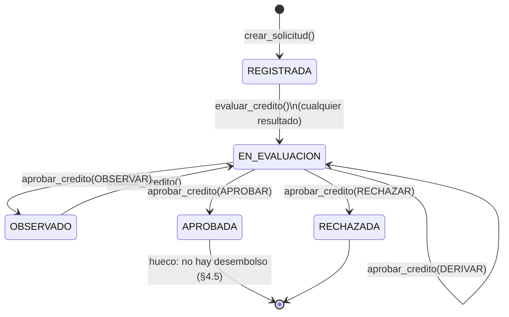

# Créditos en CORE: motor de reglas, puntaje y flujo

**Responsable:** Leonardo Oliver Lonasco Santamarina (Sección B)
**Origen:** `TAREAS_POR_INTEGRANTE.md` (23/oct/2026), Actividades 1 y 2
**Código revisado:** `backend/CORE/services/creditossvc.py`
**Pruebas:** `CORE/tests/test_calendario_correcciones.py` y `CORE/tests/test_creditos_motor_flujo.py`

---

## 0. Actividad 1 — correcciones aplicadas

| Hallazgo (Informe de Errores BNA) | Antes | Después |
|---|---|---|
| #4 TEA redondeada a 2 decimales | `D(tasa_tea)` convertía 0.185 en 0.19 y 0.1050 en 0.11 | La TEA se usa exacta; la tasa mensual se calcula con 34 dígitos. Solo se redondean importes de dinero |
| #5 Calendario sin validar entradas | 0 cuotas → `DivisionByZero`; cuotas negativas → calendario vacío; monto negativo → cuotas negativas | `ValidationError` con códigos `NUMERO_CUOTAS_INVALIDO`, `MONTO_INVALIDO`, `TEA_INVALIDA` y `TEA_FUERA_DE_RANGO` |
| #6 Vencimientos a 30 días | Desde el 31-ene la primera cuota caía el 2-mar | Meses calendario: 28-feb, 31-mar, 30-abr… Si el día no existe, se usa el último día del mes |

**Impacto medido del hallazgo #4.** En un crédito hipotecario de S/ 200 000 a TEA 10.50 % y 240 cuotas, la cuota pasaba de S/ 1 933.51 a S/ 1 994.28: S/ 60.77 de más cada mes y S/ 14 584.80 en toda la vida del crédito.

**Convención de la TEA.** `producto_credito.tasa_tea` guarda una fracción (0.2200 = 22 %). Se rechaza cualquier TEA fuera de [0, 5]. El tope de 5 no es un límite legal: sirve para atrapar el error de enviar 18.5 (porcentaje) en vez de 0.185 (fracción).

**Vencimientos sin dependencias nuevas.** `_sumar_meses()` equivale a `fecha + relativedelta(months=n)` de `python-dateutil`, que no está en `requirements.txt`. Se calcula siempre desde la fecha inicial, para que un día 31 que cayó en 28 de febrero vuelva al 31 en marzo.

**Última cuota.** La última cuota absorbe el residuo de redondear cada cuota e interés a céntimos. Ese residuo crece con el interés compuesto: en el hipotecario de ejemplo, la última cuota es S/ 1 937.37 (S/ 3.86 más que las demás). Es el comportamiento esperado del método francés con cuota redondeada, no un error.

---

## 1. Flujo CREAR → EVALUAR → APROBAR



| Paso | Función | Qué valida | Qué escribe | Estado final de la solicitud |
|---|---|---|---|---|
| CREAR_SOLICITUD_CREDITO | `crear_solicitud()` | Cliente existe; producto activo; monto > 0; plazo dentro del rango del producto | `sol_solicitud`, `sol_historial_estado`, `sol_fiador`, `sol_garantia`, `sol_calendario_version` (SIMULADO), `sol_cuota_calendario`, `auditoria_evento` | REGISTRADA |
| EVALUAR_CREDITO | `evaluar_credito()` | Solicitud en REGISTRADA, EN_EVALUACION u OBSERVADO; existe situación financiera (en el payload o en tabla) | `eva_situacion_financiera` (si viene en el payload), `eva_evaluacion`, `sol_historial_estado`, `auditoria_evento` | **EN_EVALUACION, sea cual sea el resultado** |
| APROBAR_CREDITO | `aprobar_credito()` | Decisión ∈ {APROBAR, RECHAZAR, OBSERVAR, DERIVAR}; existe al menos una evaluación | `eva_decision_analista`, `sol_historial_estado`, `auditoria_evento` | APROBADA / RECHAZADA / OBSERVADO / EN_EVALUACION |

Observación: el resultado de la evaluación (APROBADO, OBSERVADO, RECHAZADO) queda en `eva_evaluacion`, pero **no cambia el estado de la solicitud**. Esto explica el hallazgo H-B1 (§4.1).

---

## 2. Motor de reglas

### 2.1 Variables que evalúan las reglas

| Variable | Cálculo | Observación |
|---|---|---|
| `ratio_capacidad` | (cuota estimada + cuota de otros créditos) / ingresos mensuales, a 4 decimales | Si ingresos ≤ 0, el código usa 0 (ver H-A3) |
| `dias_mayor_mora` | Días de mayor mora en la central de riesgos | Si no se envía, vale 0: "no consultado" se trata igual que "sin mora" |
| `monto_solicitado` | Monto de la solicitud | Disponible, pero ninguna regla sembrada lo usa |

### 2.2 Operadores (`_evaluar_regla`)

| Operador | La regla dispara si… | Extremos | Si el umbral es NULL |
|---|---|---|---|
| MAYOR | valor > `valor_min` | Estricto: el umbral exacto **no** dispara | Compara contra 0 sin avisar |
| MENOR | valor < `valor_min` | Estricto | Compara contra 0 sin avisar |
| IGUAL | valor = `valor_min` | Exacto | Nunca dispara |
| ENTRE | `valor_min` ≤ valor ≤ `valor_max` | Incluye ambos extremos | Extremo abierto |
| EXCLUYE | `valor_min` ≤ valor ≤ `valor_max` | Incluye ambos extremos | Extremo abierto |

**Semántica de EXCLUYE.** El código de EXCLUYE es idéntico al de ENTRE: dispara cuando el valor está **dentro** de la banda. La prueba `test_excluye_se_comporta_igual_que_entre` lo comprueba en 60 combinaciones de valores y bandas, incluidas las de extremos NULL. El efecto de una regla (aprobar, observar o rechazar) ya lo define la columna `resultado`, así que EXCLUYE no aporta nada que ENTRE no haga, y su nombre sugiere lo contrario ("fuera de la banda"). Ninguna regla sembrada lo usa.

Opciones para el Comité de Créditos:
- **(a) Eliminarlo del ENUM** (recomendado: no se usa y su nombre confunde).
- **(b) Redefinirlo como el complemento de ENTRE**: que dispare cuando el valor está **fuera** de la banda.

Mientras no se decida, no conviene crear reglas nuevas con EXCLUYE.

### 2.3 Reglas sembradas (`10_seed_catalogos.sql`)

| Regla | Variable | Operador | Banda | Resultado | Peso |
|---|---|---|---|---|---|
| RATIO_SALUDABLE | ratio_capacidad | ENTRE | [0, 0.80] | APROBAR | 1.00 |
| RATIO_LIMITE | ratio_capacidad | ENTRE | [0.80, 1.00] | OBSERVAR | 1.00 |
| RATIO_INSUFICIENTE | ratio_capacidad | MAYOR | > 1.00 | RECHAZAR | 1.00 |
| MORA_RECIENTE | dias_mayor_mora | MAYOR | > 30 | OBSERVAR | 0.50 |
| MORA_GRAVE | dias_mayor_mora | MAYOR | > 120 | RECHAZAR | 1.00 |

---

## 3. Puntaje y decisión: ¿la fórmula es correcta?

**Fórmula actual (`evaluar_credito`):**
- puntaje = máx(0, 100 − Σ `int(float(peso) × 40)`), sumando sobre **todas** las reglas que coinciden;
- resultado = el más severo entre las reglas que coinciden (RECHAZAR > OBSERVAR > APROBAR);
- si el resultado es APROBADO y el puntaje es menor a 50, pasa a OBSERVADO;
- riesgo: ≥ 80 BAJO, ≥ 50 MEDIO, ≥ 25 ALTO, < 25 MUY_ALTO.

**Respuesta corta: no es correcta.** Tiene tres errores de lógica y uno de implementación.

### 3.1 H-A1 — Las reglas APROBAR restan puntos

El descuento se aplica a toda regla que coincide, sin mirar su resultado. Un solicitante sano cumple RATIO_SALUDABLE (resultado APROBAR, peso 1.00) y **pierde 40 puntos por cumplirla**.

| Caso | Reglas que coinciden | Puntaje | Riesgo | Resultado |
|---|---|---|---|---|
| Sano: ratio 0.09, sin mora | RATIO_SALUDABLE | 60 | MEDIO | APROBADO |
| Sano con 45 días de mora | RATIO_SALUDABLE + MORA_RECIENTE | 40 | ALTO | OBSERVADO |

Con las reglas sembradas, **todo solicitante con ingresos pierde 40 puntos** (siempre coincide alguna de las tres reglas de ratio), así que el puntaje máximo alcanzable es 60 y el riesgo **BAJO es inalcanzable**. Prueba: `test_solicitante_sano_no_pierde_puntos_por_cumplir_la_regla_saludable` (xfail).

### 3.2 H-A2 — Frontera 0.80 duplicada

RATIO_SALUDABLE y RATIO_LIMITE incluyen ambas el 0.80. Un ratio de exactamente 0.8000 activa las dos: puntaje 20, riesgo MUY_ALTO, resultado OBSERVADO. Prueba: `test_ratio_exacto_en_la_frontera_activa_una_sola_regla` (xfail).

**Corrección sin tocar código:** como el ratio se guarda con 4 decimales, basta sembrar RATIO_LIMITE con `valor_min = 0.8001`. Las bandas quedan contiguas y sin solaparse.

### 3.3 H-A3 — Un solicitante sin ingresos aparece como el más solvente

Si los ingresos son 0 o negativos, el código pone ratio = 0, que es el mejor valor posible. El solicitante cumple RATIO_SALUDABLE y queda **APROBADO**. Prueba: `test_solicitante_sin_ingresos_no_es_aprobado` (xfail).

Corrección propuesta: con ingresos ≤ 0, rechazar la evaluación (`ValidationError("INGRESOS_INVALIDOS", …)`) o forzar el resultado RECHAZADO.

### 3.4 H-A4 — `float` e `int` en la ponderación

- `int()` **trunca**: un peso de 0.02 da 0.8 → 0 puntos (la regla no tiene efecto); 0.29 da 11.6 → 11; 0.99 da 39.6 → 39.
- Se verificó que, para pesos entre 0.01 y 5.00, `float` no altera ningún resultado entero. Aun así, viola la convención del proyecto de no usar `float`: hay que usar `Decimal` y redondear con `ROUND_HALF_UP`.
- La constante 40 no está documentada, y `peso` es `DECIMAL(5,2)` sin tope: una sola regla con peso 2.5 deja el puntaje en 0.

### 3.5 Umbral de OBSERVADO (< 50)

Es coherente con las bandas de riesgo: 50 es el inicio de MEDIO. Pero conviene que el Comité confirme dos efectos:
- **El puntaje nunca rechaza por sí solo**: con 0 puntos, el resultado como máximo es OBSERVADO. RECHAZADO solo ocurre si coincide una regla RECHAZAR.
- Por H-A1, el umbral se alcanza con mucha facilidad: un solicitante sano con una mora menor ya queda OBSERVADO.

### 3.6 Propuesta de corrección (pendiente de aprobación)

```python
# Solo penalizan las reglas que observan o rechazan; Decimal en lugar de float.
PUNTOS_POR_PESO = Decimal("40")
...
if coincide and regla.resultado in ("OBSERVAR", "RECHAZAR"):
    descuento = (Decimal(regla.peso) * PUNTOS_POR_PESO).quantize(Decimal("1"), rounding=ROUND_HALF_UP)
    puntaje_base -= int(descuento)

# Antes de calcular el ratio
if ingresos <= CERO:
    raise ValidationError("INGRESOS_INVALIDOS", "Los ingresos mensuales deben ser mayores a cero.")
```

No se aplicó porque cambia el resultado de todas las evaluaciones: es una decisión de negocio del Comité de Créditos (sección 2.3 del enunciado).

---

## 4. Aprobación y desembolso

### 4.1 H-B1 — Se puede aprobar una evaluación RECHAZADA

`aprobar_credito()` exige que exista una evaluación, pero no mira su resultado. Como la solicitud queda en EN_EVALUACION incluso si la evaluación salió RECHAZADO (§1), una decisión APROBAR la deja APROBADA. Prueba: `test_no_se_puede_aprobar_una_evaluacion_rechazada` (xfail).

Opciones: bloquearlo, o permitirlo solo con justificación obligatoria y un nivel de aprobación superior.

### 4.2 H-B2 — Aprobación sin aprobador identificado

`id_analista` es opcional. Sumado a la falta de autenticación (hallazgo #1, a cargo de Nicolás Ayerve), no queda evidencia de quién aprobó. Cuando exista el JWT, `id_analista` debe salir del token y ser obligatorio.

### 4.3 H-B3 — El monto aprobado no tiene tope

Se puede aprobar más de lo solicitado y más que `monto_maximo_sugerido`. Prueba: `test_no_se_aprueba_mas_de_lo_solicitado` (xfail).

### 4.4 H-B4 — No existe el workflow de aprobación según monto

El enunciado (módulo 12, EVALUACIÓN) pide un *workflow de aprobación según monto*. Hoy cualquier decisión aprueba cualquier monto, sin niveles. Hace falta una tabla de niveles. **Los importes del ejemplo son ilustrativos**: los define el Comité de Créditos.

| Monto aprobado | Quién puede aprobar (ejemplo) |
|---|---|
| hasta S/ X | Analista de créditos |
| hasta S/ Y | Supervisor de créditos |
| más de S/ Y | Comité de Créditos |

### 4.5 Hueco de desembolso (confirmado)

Coincide con el punto 2 de `CORE/README.md`. Después de APROBAR:
- no se crea `cob_credito` ni `cob_cuota`;
- no hay abono en cuenta ni asiento contable de desembolso;
- el calendario sigue en SIMULADO y nunca pasa a OFICIAL.

Prueba: `test_aprobar_no_genera_credito_ni_desembolso_hueco_conocido`.

El docstring del módulo cita RGN-12 ("solo una solicitud evaluada como APROBADA genera cuenta de crédito y asiento de desembolso") como si estuviera implementada, y no lo está. **Consecuencia:** `registrar_pago()` y `consultar_deuda()` necesitan un `cob_credito`, así que el ciclo de pagos no puede recorrerse de punta a punta desde una solicitud creada en el sistema.

**Recomendación.** El enunciado define DESEMBOLSO como módulo propio (módulo 13: desembolsar el préstamo a una cuenta del cliente). Ese módulo debe orquestar el desembolso, y CORE debe exponer las operaciones base:
1. pasar el calendario a OFICIAL;
2. crear `cob_credito` y `cob_cuota` a partir del calendario oficial;
3. abonar en la cuenta del cliente con su asiento contable (usando `movimientos`).

Esto debe coordinarse con los equipos de Desembolso y Cobranza.

---

## 5. Decisiones pendientes del Comité de Créditos

- [ ] EXCLUYE: ¿eliminarlo o redefinirlo como "fuera de la banda"? (§2.2)
- [ ] ¿Las reglas APROBAR dejan de restar puntos? (§3.1)
- [ ] Sembrar RATIO_LIMITE desde 0.8001 (§3.2)
- [ ] Ingresos ≤ 0: ¿rechazo automático? (§3.3)
- [ ] Escala de `peso`, constante 40 y redondeo (§3.4)
- [ ] ¿El puntaje puede rechazar por sí solo? (§3.5)
- [ ] Central de riesgos no consultada: ¿bloquear la evaluación en vez de asumir 0 días? (§2.1)
- [ ] ¿Se puede aprobar una evaluación RECHAZADA? ¿Con qué nivel? (§4.1)
- [ ] Niveles de aprobación por monto (§4.4)
- [ ] ¿Dónde vive el desembolso: CORE o el módulo Desembolso? (§4.5)

---

## 6. Pruebas

```bash
cd backend
python -m pytest CORE/tests -q -rx
```

| Archivo | Qué cubre |
|---|---|
| `test_calendario_correcciones.py` | Actividad 1: TEA exacta, validación de entradas, vencimientos por mes calendario, cuadre del calendario |
| `test_creditos_motor_flujo.py` | Actividad 2: semántica de operadores, flujo completo sobre SQLite en memoria, hallazgos H-A1 a H-B3 |

Las pruebas `xfail(strict=True)` describen el comportamiento esperado de los hallazgos pendientes. Hoy fallan a propósito y la suite sigue en verde. Cuando alguien corrija uno, pytest reportará XPASS como error: esa es la señal para quitar su `xfail`.
